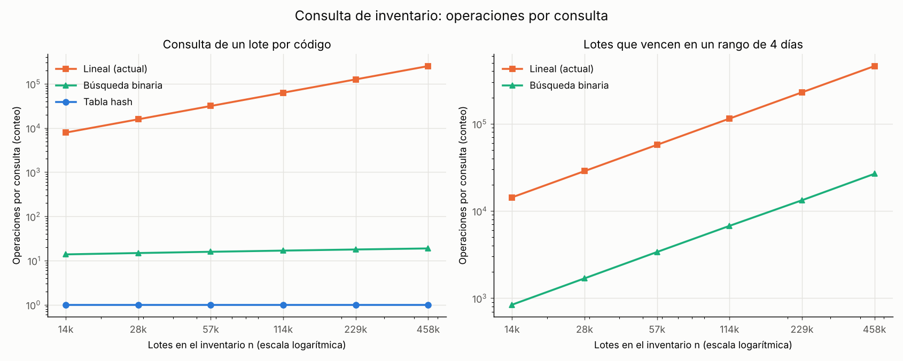
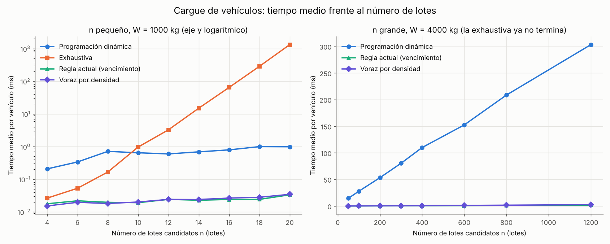
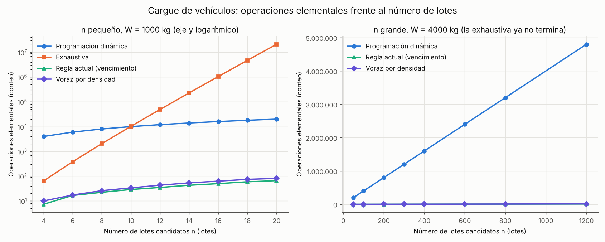
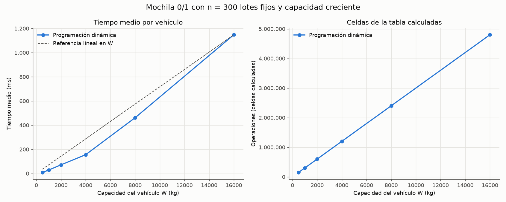
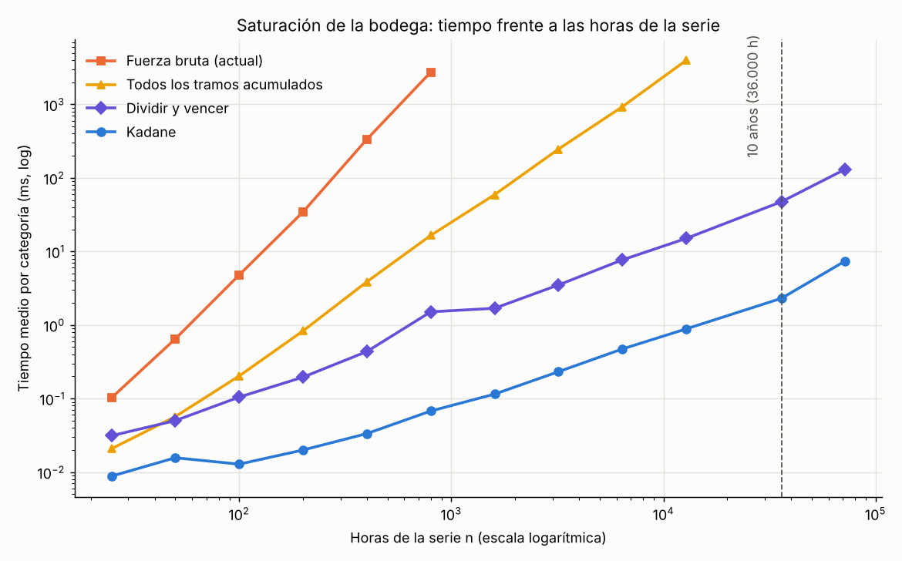
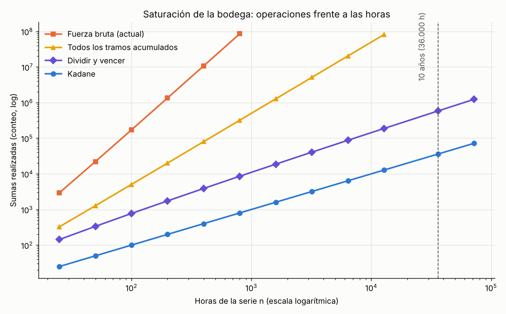
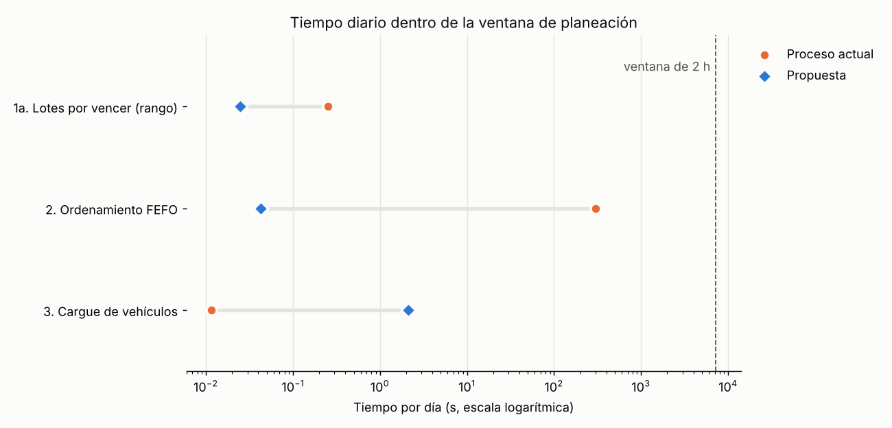
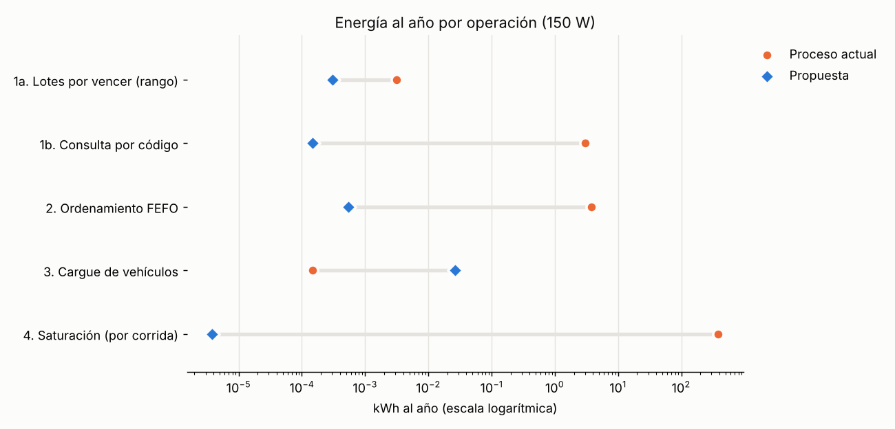

# Proyecto final — Caso 3: Banco de alimentos

**Integrantes**

- David Viloria
- Leonel
- Luis Lopera
- Juana Ospina

**Caso asignado:** Caso 3 — Banco Regional de Alimentos (planeación de despachos).

**Entregables:** este `README.md` (informe técnico) y [`informe.pdf`](informe.pdf), que tiene el mismo contenido.

## Resumen ejecutivo

La planeación de despachos del banco tarda hoy cerca de 4 horas y media, pero su ventana es de 2 horas (03:00 a 05:00). Analizamos las cuatro operaciones críticas del proceso y diseñamos, implementamos y medimos al menos dos estrategias para cada una:

| Operación | Hoy | Recomendamos | Complejidad: hoy → propuesta | Tiempo con el volumen real: hoy → propuesta |
|---|---|---|---|---|
| 1. Consulta de inventario | Recorrer toda la lista | Tabla hash (por código) + búsqueda binaria sobre la lista FEFO (por rango) | Θ(n) → Θ(1) y Θ(log n + r) | 4,1 min/día de consultas → 12 ms |
| 2. Ordenamiento FEFO | Inserción sobre toda la lista | Ordenar por mezcla solo los lotes nuevos y fusionarlos con la lista del día anterior (dividir y vencer) | Θ(n·k) → Θ(k log k + n) | 5,0 min → 43 ms |
| 3. Cargue de vehículos | Cargar por vencimiento hasta que no quepa el siguiente | Mochila 0/1 por programación dinámica | Θ(n log n), no óptima → Θ(n·W), óptima | 12 ms → 2,1 s, con la carga máxima garantizada |
| 4. Saturación de la bodega | Evaluar y sumar todos los tramos | Kadane (programación dinámica) | Θ(n³) → Θ(n) | ≈ 106 días → 0,09 s |

Con la propuesta, la parte de la planeación que va dentro de la ventana (operaciones 1, 2 y 3) baja a unos **2,2 segundos por día**. Frente a la línea base que reporta el cliente (4,5 h diarias en un equipo de 150 W), eso ahorra unos **202 kWh al año**. A eso se suman unos **382 kWh** por cada corrida del análisis de saturación, que con la estrategia actual tardaría más de tres meses. Lo más valioso, sin embargo, no es la energía del computador: los vehículos salen a tiempo y llenos con el máximo valor nutricional. Eso es menos comida vencida en bodega.

## Contenido

1. [Análisis del problema](#1-análisis-del-problema)
2. [Diseño de la solución](#2-diseño-de-la-solución)
3. [Implementación](#3-implementación)
4. [Evaluación del desempeño](#4-evaluación-del-desempeño)
5. [Análisis comparativo](#5-análisis-comparativo)
6. [Implicaciones éticas, sociales y ambientales](#6-implicaciones-éticas-sociales-y-ambientales)
7. [Conclusiones](#7-conclusiones)
8. [Anexos](#8-anexos)
9. [Reproducción](#9-reproducción)

---

## 1. Análisis del problema

### 1.1 Descripción del problema computacional

El Banco Regional de Alimentos recibe donaciones (muchas de ellas próximas a vencer) y las distribuye a 420 organizaciones beneficiarias. Cada madrugada, un proceso en un computador de escritorio de 150 W decide qué lotes salen de la bodega, en qué orden y en qué vehículo. El inventario tiene unos 220.000 lotes activos y cada día llegan entre 6.000 y 9.000 nuevos.

Desde el punto de vista computacional, el proceso es una cadena de cuatro problemas sobre la misma colección de lotes:

1. **Buscar** lotes: por su código (durante el alistamiento) y por rango de fechas de vencimiento (durante la planeación).
2. **Ordenar** la colección según la política FEFO (*first expired, first out*).
3. **Escoger** para cada vehículo el subconjunto de lotes de mayor valor nutricional que cabe en su capacidad: es una mochila 0/1.
4. **Analizar** una serie histórica para encontrar el tramo de horas en que más creció el inventario: es un subarreglo de suma máxima.

Las operaciones 1 (consulta por rango), 2 y 3 deben caber en la ventana de planeación de 2 horas (03:00 a 05:00). La consulta por código ocurre durante el alistamiento (desde las 05:30) y cada una debe responder en menos de 1 segundo. La operación 4 es un análisis aparte, sin ventana fija.

### 1.2 Operaciones críticas y su costo en el proceso actual

Para cada operación reconstruimos en Python la estrategia que el caso describe, la medimos con datos sintéticos de tamaño creciente y extrapolamos al volumen real con la forma de su curva (sección 4).

| Operación | Tamaño n en el caso | Estrategia actual | Orden de crecimiento | Tiempo actual estimado (volumen real) | ¿Dentro de la ventana? |
|---|---|---|---|---|---|
| 1a. Lotes por vencer (rango) | 229.000 lotes | Recorre toda la lista | Θ(n) por consulta | 0,25 s al día (14 consultas) | Sí |
| 1b. Consulta por código | 229.000 lotes, 30.000 consultas/día | Recorre la lista hasta encontrarlo | Θ(n) por consulta | 12,5 ms en el peor caso; 4,1 min/día en total | No aplica (alistamiento); cumple < 1 s |
| 2. Ordenamiento FEFO | 229.000 lotes, de ellos k = 9.000 nuevos | Inserción sobre la lista con los nuevos al final | Θ(n·k), cuadrático porque k crece con n | **5,0 min al día** | Sí, pero es la más cara de la ventana |
| 3. Cargue de vehículos | 14 vehículos, hasta 600 lotes y 4.000 kg | Cargar por vencimiento hasta que no quepa el siguiente | Θ(n log n) por vehículo | 12 ms al día, pero **no da el máximo** (los vehículos salen al 78 %) | Sí, pero incumple la restricción de valor máximo |
| 4. Saturación de la bodega | 40 categorías × 36.000 horas | Evalúa todos los tramos, sumando cada uno | Θ(n³) por categoría | **≈ 106 días** por corrida | No aplica; en la práctica no termina |

**Las operaciones de mayor costo computacional son la 4 (por lejos: cúbica) y la 2 (cuadrática).** La 2 es la que más pesa dentro de la ventana. La 3 es barata, pero su problema es otro: incumple la restricción de cargar el valor máximo.

**Diferencia con lo que reporta el cliente.** Nuestra reconstrucción de las operaciones 1 a 3 suma unos 5 minutos diarios, mientras el cliente reporta 4,5 horas. El caso no describe el resto del proceso actual: el programa heredado, la lectura y escritura de archivos, el cargue que hoy hace el coordinador a mano y el hardware real. Por eso usamos dos líneas base: la **reportada** (4,5 h), para la energía y la ventana, y la **reconstruida** (nuestras mediciones), para comparar estrategias en igualdad de condiciones. Las dos llevan a la misma conclusión.

### 1.3 Costo energético del proceso actual (línea base)

Usamos `kWh = kW × h`, con el computador de 150 W (0,150 kW) y 300 días de operación al año.

| Línea base | Tiempo | Energía por día | Energía al año |
|---|---|---|---|
| **Planeación reportada por el cliente** (operaciones 1 a 3) | 4,5 h | 0,150 × 4,5 = **0,675 kWh** | 0,675 × 300 = **202,5 kWh** |
| Planeación reconstruida (1a + 2 + 3) | 5,0 min | 0,0126 kWh | 3,8 kWh |
| Consultas por código del alistamiento (1b) | 4,1 min | 0,0102 kWh | 3,0 kWh |
| Análisis de saturación (4), una corrida al año | ≈ 106 días | — | **≈ 382 kWh** por corrida |

Las cifras de las filas 2 a 4 son estimaciones a partir de nuestras mediciones (sección 4); la de la fila 1 es el dato del cliente.

### 1.4 Entradas, salidas y restricciones

#### 1.4.1 Operación 1 — Consulta de inventario

| Elemento | Descripción |
|---|---|
| Entradas | El inventario: n lotes (`codigo_lote`, `categoria`, `fecha_vencimiento`, `peso_kg`, `raciones`, `donante`), con n ≈ 220.000 activos + hasta 9.000 nuevos. Una consulta es un código, o un rango de fechas `[desde, hasta]`. |
| Salidas | Por código: el lote, o "no existe". Por rango: todos los lotes con `desde ≤ fecha_vencimiento ≤ hasta`, en orden FEFO. |
| Restricciones | Cada consulta por código responde en **menos de 1 s**. Las consultas por rango caben en la ventana de 2 h, junto con las operaciones 2 y 3. Ningún lote del rango se omite y ninguno de fuera se incluye. El registro original no se modifica. |
| Volumen | 30.000 consultas por código al día. Asumimos 14 consultas por rango en la planeación (una por ruta). |

#### 1.4.2 Operación 2 — Ordenamiento FEFO

| Elemento | Descripción |
|---|---|
| Entradas | La lista del día anterior, ya en orden FEFO (n − k lotes), y los k lotes nuevos del día, en orden de llegada (k entre 6.000 y 9.000). |
| Salidas | Una sola lista con los n lotes, ordenada por fecha de vencimiento y, a igual fecha, por categoría. Además, la lista de lotes **despachables**, sin los vencidos. |
| Restricciones | **Ningún lote vencido se despacha.** Dentro de una categoría, siempre sale primero el lote que vence primero. Cabe en la ventana de 2 h. El registro original de cada lote no se modifica. |

#### 1.4.3 Operación 3 — Cargue de los vehículos

Cada madrugada, entre las 03:00 y las 05:00, el banco de alimentos planea qué lotes sube a cada vehículo. Un lote es una unidad que no se parte: o va completo en el vehículo o se queda en la bodega. El objetivo es que cada vehículo salga con el mayor valor nutricional posible sin pasarse de su capacidad.

**Entradas** (por cada vehículo, es decir, por cada ruta):

| Dato | Tipo y unidad | Límites que informa el caso |
|---|---|---|
| `capacidad_kg` (W) | entero, kilogramos | entre 2.500 y 4.000 kg |
| `lotes` | lista de tuplas `(peso_kg, valor_nutricional, dias_para_vencer)` | entre 300 y 600 lotes candidatos por ruta |
| `peso_kg` de cada lote | entero, kilogramos | mayor que 0 |
| `valor_nutricional` de cada lote | entero, raciones ponderadas por la prioridad de la categoría | mayor o igual que 0 |
| `dias_para_vencer` de cada lote | entero, días | solo lo usa la regla actual |

En un día hay 14 vehículos, así que la operación se ejecuta 14 veces, una por ruta.

**Salida:** el valor nutricional total cargado y la lista de índices (posiciones en `lotes`) de los lotes que suben, en orden creciente.

**Restricciones del negocio:**

1. La suma de los pesos de los lotes cargados no puede superar `capacidad_kg`.
2. Ningún lote se fracciona: cada índice aparece como máximo una vez y aporta su valor completo.
3. El valor cargado debe ser **el máximo posible**, no una aproximación.
4. Todo debe caber en la ventana de planeación de 2 horas (03:00 a 05:00), que la operación 3 comparte con la consulta por rango (operación 1) y el ordenamiento FEFO (operación 2), en un computador de unos 150 W.

#### 1.4.4 Operación 4 — Saturación de la bodega

| Elemento | Descripción |
|---|---|
| Entradas | Para cada una de las 40 categorías, una serie de n enteros: el cambio neto del inventario en kg en cada hora de operación (lo que entró menos lo que salió o se descartó; puede ser negativo). Diez años son n ≈ 36.000 horas (12 h × 300 días × 10). |
| Salidas | Por categoría, el tramo de horas consecutivas `[inicio, fin]` con mayor suma (crecimiento acumulado), y esa suma en kg. |
| Restricciones | El tramo reportado es **el de mayor crecimiento acumulado**, no una aproximación. La serie original no se modifica. |

### 1.5 Supuestos

**Generales.**

- Los datos del cliente son válidos y caben en memoria. Trabajamos con un solo hilo de ejecución, como el computador del banco.
- No procesamos el volumen real completo: generamos datos sintéticos con semilla fija, medimos en tamaños crecientes y extrapolamos con la forma de cada curva. Cuando el volumen real se podía ejecutar en pocos segundos (operaciones 1, 2 y 4 con las estrategias propuestas), lo medimos directamente.
- **300 días de operación al año**, tal como lo informa el cliente, para todas las proyecciones anuales.
- Las fechas se representan como un número entero de días contados desde hoy (0 = hoy). Así se pueden comparar y restar sin convertir fechas.

**Operación 1.** Los códigos de lote son únicos. Un código consultado que no existe (por ejemplo, mal digitado) es un caso válido y debe responder "no existe". Asumimos 14 consultas por rango al día, una por ruta, del tipo "¿qué vence en las próximas 72 horas?". Si fueran más, el tiempo crece en proporción y la conclusión no cambia.

**Operación 2.** La clave de orden es `(fecha_vencimiento, categoria)`. Si dos lotes tienen la misma fecha y la misma categoría, se conserva su orden de llegada (los del día anterior van primero): las tres estrategias son **estables** y dan exactamente la misma lista. Un lote cuya fecha de vencimiento es hoy todavía se puede despachar; está vencido si su fecha es anterior a hoy. Los lotes nuevos (donaciones) vencen en 1 a 30 días, así que en el orden FEFO van cerca del principio de la lista. Ese es el peor caso para la inserción.

**Operación 3.**

- **Pesos enteros en kilogramos.** El caso así lo dice, y esto es lo que permite usar la capacidad como índice de la tabla. Si llegara un peso con decimales se redondearía hacia arriba, para no correr el riesgo de pasarse de la capacidad.
- **Una ruta por vehículo.** Los 14 vehículos tienen cada uno su propia lista de lotes candidatos, y la planeación de un vehículo no afecta la de otro. Un lote no compite por dos vehículos a la vez.
- **Planeación diaria.** La ventana de 03:00 a 05:00 se repite cada día de operación; el cliente informa 300 días al año.
- **Interpretación de la regla actual.** El coordinador ordena los lotes del que vence primero al que vence último. Los va subiendo en ese orden y **se detiene en el primer lote que no cabe**, aunque más adelante haya lotes más livianos que sí cabrían. Si dos lotes vencen el mismo día, va primero el que aparece antes en la lista. Ejemplo: con 100 kg de capacidad y los lotes A (60 kg, vence en 1 día), B (50 kg, 2 días) y C (10 kg, 3 días), la regla sube A, ve que B ya no cabe (110 kg) y para. C nunca se revisa. El vehículo sale con 60 kg.
- **Interpretación de la regla por densidad.** Se ordena por valor nutricional por kilogramo, de mayor a menor (en empate, el índice menor). Esta regla **no** se detiene: si un lote no cabe, lo salta y prueba el siguiente. La comparación se hace con enteros (`v_i · w_j` frente a `v_j · w_i`) para no depender del redondeo.
- **Empates en el óptimo.** Si hay varias cargas con el mismo valor máximo, cualquiera es válida. Las pruebas comparan el valor, no la lista exacta de lotes.
- **Datos sintéticos.** Los lotes de las mediciones se generan en cinco categorías inventadas por el equipo (proteína, lácteos, frutas y verduras, granos, enlatados). Cada categoría tiene sus propias raciones por kg, su prioridad y su rango de días para vencer, con pesos entre 20 y 500 kg. No son cifras del cliente: solo le dan una estructura realista a los datos.

**Operación 4.** "Evalúa todos los tramos posibles" lo interpretamos como el programa más directo: para cada pareja (inicio, fin) vuelve a sumar las horas del tramo, Θ(n³). Esta lectura es coherente con que hoy tarde "más de un día" (nuestra extrapolación da unos 3 meses). Un tramo tiene al menos una hora. Si hay empates, cualquier tramo con la suma máxima es válido: las pruebas comparan la suma. Asumimos que el análisis se corre **una vez al año**, antes de decidir el alquiler del cuarto frío de temporada. Los datos sintéticos tienen ruido alrededor de un promedio levemente negativo y una temporada de 4 a 8 semanas al año en la que el inventario crece.

---

## 2. Diseño de la solución

### 2.1 Estructuras de datos seleccionadas

| Estructura | Dónde se usa | Por qué |
|---|---|---|
| Tupla con nombre `Lote` (inmutable) | Operaciones 1 y 2 | Un lote no se puede modificar por error: esto protege la trazabilidad sanitaria. Además, se lee como un registro (`lote.vencimiento`). |
| Tabla hash (`dict` código → lote) | Operación 1 | Busca por código en Θ(1) en promedio. Guarda referencias a los mismos lotes, no copias. |
| Lista ordenada + búsqueda binaria | Operaciones 1 y 2 | La lista en orden FEFO, que produce la operación 2, sirve también como índice por fecha: el rango se ubica con dos búsquedas binarias. |
| Listas ordenadas que se fusionan | Operación 2 | La lista del día anterior ya está ordenada: basta ordenar los k nuevos y fusionar, sin reordenar todo. |
| Tabla K de (n + 1) × (W + 1) enteros | Operación 3 | Guarda la solución de cada subproblema de la mochila y permite reconstruir qué lotes suben. |
| Dos variables (Kadane) | Operación 4 | El mejor tramo que termina en la hora actual y el mejor visto hasta ahora: espacio Θ(1). |

### 2.2 Operación 1 — Consulta de inventario

**Estrategias diseñadas.**

| Consulta | Estrategia A (actual) | Estrategia B | Estrategia C (recomendada) |
|---|---|---|---|
| Por código | Búsqueda lineal: Θ(n) | Búsqueda binaria sobre la lista ordenada por código: Θ(log n) | **Tabla hash**: Θ(1) en promedio |
| Por rango de vencimiento | Búsqueda lineal: Θ(n) | — | **Dos búsquedas binarias sobre la lista FEFO**: Θ(log n + r) |

**Estrategia de diseño.** La búsqueda binaria es una estrategia de **reducción a la mitad** (de la familia de dividir y vencer): en cada paso descarta la mitad de la lista donde el objetivo no puede estar. Funciona porque la lista está ordenada, y en el proceso ya existe una lista ordenada por vencimiento: la que produce la operación 2. Así, el índice por fecha no cuesta nada adicional. La tabla hash cambia memoria (un diccionario de 229.000 entradas, construido una vez al día en unos 23 ms) por consultas en tiempo constante.

**Cómo reduce el consumo.** El costo de construir los índices se paga una vez al día. Después, cada una de las 30.000 consultas por código revisa 1 entrada en vez de unas 125.000 en promedio.

**Pseudocódigo del rango por búsqueda binaria.**

```
POR_VENCER(fefo, vencimientos, desde, hasta):
    inicio ← primera posición i con vencimientos[i] ≥ desde      ▹ búsqueda binaria
    fin    ← primera posición i con vencimientos[i] > hasta      ▹ búsqueda binaria
    devolver fefo[inicio .. fin − 1]                             ▹ los r lotes del rango, ya en orden FEFO

PRIMERA_NO_MENOR(valores, objetivo):
    bajo ← 0;  alto ← |valores|
    mientras bajo < alto:
        medio ← ⌊(bajo + alto) / 2⌋
        si valores[medio] < objetivo:  bajo ← medio + 1          ▹ la respuesta está a la derecha
        si no:                         alto ← medio              ▹ la respuesta está aquí o a la izquierda
    devolver bajo
```

**Ejemplo resuelto a mano.** En el **Anexo A.1** se busca un código y un rango, paso a paso, en un inventario de 8 lotes. Con un código que no existe, la búsqueda lineal hace 8 comparaciones y la binaria 3; el rango "vence entre los días 2 y 4" sale con dos búsquedas binarias, ya en orden FEFO.

### 2.3 Operación 2 — Ordenamiento FEFO

**Estrategias diseñadas.**

| Estrategia | Idea | Complejidad |
|---|---|---|
| A. Inserción (actual) | Anexa los k nuevos al final y ordena todo por inserción. Los viejos casi no se mueven, pero cada nuevo vence pronto y tiene que desplazarse casi hasta el principio. | Θ(n·k); como k ≈ 3,9 % de n, es **cuadrático** |
| B. Mezcla de toda la lista | Ordenamiento por mezcla (dividir y vencer) de los n lotes. | Θ(n log n), sin importar cómo llegue la lista |
| C. Ordenar nuevos + fusionar (**recomendada**) | Ordena por mezcla solo los k nuevos y los fusiona con la lista vieja, que ya está ordenada, en una sola pasada. | **Θ(k log k + n)** |

**Por qué el problema admite dividir y vencer.** Ordenar una lista se puede partir en ordenar dos mitades independientes y después combinarlas: la fusión de dos listas ordenadas es lineal y da una lista ordenada. La estrategia C lleva esa idea un paso más allá: el día anterior ya dejó resuelto el subproblema más grande (los n − k lotes viejos ordenados), así que solo hay que resolver el pequeño (los k nuevos) y hacer **una** fusión. Es la misma operación "combinar" del ordenamiento por mezcla, aplicada una sola vez.

**Cómo reduce el consumo.** Con el volumen real, la inserción hace del orden de n·k ≈ 2.000 millones de pasos. La estrategia C hace unas 135.000 comparaciones. En tiempo, son unas 7.000 veces menos: 5 minutos frente a 43 ms.

**No se despacha nada vencido.** Con la lista en orden FEFO, los lotes vencidos (vencimiento < hoy) forman un bloque al principio. `despachables` encuentra con una búsqueda binaria dónde termina ese bloque y devuelve solo el resto. Es una segunda barrera, independiente del ordenamiento.

**Pseudocódigo.**

```
FUSIONAR_NUEVOS(viejos, nuevos):
    nuevos_ordenados ← MEZCLA(nuevos)                 ▹ Θ(k log k)
    devolver FUSIONAR(viejos, nuevos_ordenados)       ▹ Θ(n)

FUSIONAR(izq, der):                                    ▹ estable: en empate gana la izquierda
    resultado ← [ ];  i ← 0;  j ← 0
    mientras i < |izq| y j < |der|:
        si clave(der[j]) < clave(izq[i]):  agregar der[j];  j ← j + 1
        si no:                             agregar izq[i];  i ← i + 1
    agregar lo que quede de izq y de der
    devolver resultado

MEZCLA(lista):
    si |lista| ≤ 1: devolver lista
    devolver FUSIONAR(MEZCLA(primera mitad), MEZCLA(segunda mitad))
```

**Ejemplo resuelto a mano.** En el **Anexo A.2** se ordenan, paso a paso, 6 lotes viejos y 3 nuevos (uno de ellos ya vencido). La fusión llega a la lista correcta con 9 comparaciones y la inserción con 21, y `despachables` excluye el lote vencido.

### 2.4 Operación 3 — Cargue de los vehículos

#### 2.4.1 Por qué el problema admite programación dinámica

El cargue de un vehículo es una **mochila 0/1**: cada lote tiene un peso y un valor, el vehículo tiene una capacidad, y cada lote sube entero o no sube. Lo resolvemos decidiendo lote por lote si sube o no. Lo que queda después de cada decisión se describe con dos números: cuántos lotes faltan por decidir y cuántos kilogramos siguen libres.

**Subestructura óptima.** Tome una carga óptima para los primeros `i` lotes con `w` kg libres. Hay dos posibilidades:

- Si el lote `i` **no** está en esa carga, lo que se cargó es una carga óptima para los primeros `i − 1` lotes con los mismos `w` kg.
- Si el lote `i` **sí** está, el resto de la carga tiene que ser óptimo para los primeros `i − 1` lotes con `w − peso_i` kg. Si no lo fuera, se podría cambiar ese resto por uno mejor que pese lo mismo o menos, y la carga total subiría de valor. Eso contradice que fuera óptima.

Es decir, la mejor solución del problema grande se arma con la mejor solución de un problema más pequeño del mismo tipo.

**Subproblemas que se repiten.** Muchas decisiones distintas terminan en el mismo subproblema. En el ejemplo del Anexo A.3, el subproblema "lo mejor con L0 y L1 en 5 kg" (`K[2][5]`) lo necesitan dos casillas diferentes:

- `K[3][5]`, cuando decide **no** subir L2 (se queda con los mismos 5 kg),
- `K[3][10]`, cuando decide **sí** subir L2 (le quedan 10 − 5 = 5 kg).

Con 300 lotes, la búsqueda exhaustiva tendría que revisar 2³⁰⁰ subconjuntos. En cambio, solo existen `(n + 1)·(W + 1)` subproblemas distintos. Para el peor caso real son 601 × 4.001 ≈ 2,4 millones. Al guardar cada uno en una tabla, se calcula una sola vez.

**¿Por qué no una regla voraz?** Porque elegir un lote cambia la capacidad que queda, y un lote que parece buena idea ahora puede dejar un hueco que ningún otro lote llena. La sección 5.3.1 lo muestra con números para las dos reglas voraces que se usan o se podrían usar.

#### 2.4.2 La recurrencia

Definimos `K[i][w]` como **el mayor valor nutricional que se puede cargar escogiendo solo entre los primeros `i` lotes, en un vehículo con `w` kg de capacidad**. La respuesta para un vehículo es `K[n][W]`.

```
K[0][w] = 0                                                  para todo w   (caso base)

K[i][w] = K[i-1][w]                                          si peso_i > w
K[i][w] = max( K[i-1][w] ,  valor_i + K[i-1][w - peso_i] )   si peso_i <= w
```

Cada término significa:

- `K[i-1][w]`: **no subir** el lote `i`. La capacidad sigue igual y la decisión pasa a los lotes anteriores.
- `valor_i + K[i-1][w - peso_i]`: **subir** el lote `i`. Ganamos su valor completo, gastamos su peso, y con los kilos que sobran buscamos lo mejor entre los lotes anteriores. Se usa la fila `i − 1` para que el mismo lote no pueda subir dos veces.
- `max(...)`: nos quedamos con la mejor de las dos opciones. Si el lote no cabe, solo existe la primera.
- **Caso base:** sin lotes no se carga nada, así que la fila 0 es toda de ceros. Con `w = 0` tampoco cabe nada, así que la columna 0 también queda en ceros.
- **Orden de llenado:** cada casilla solo depende de la fila de arriba. Por eso la tabla se llena **fila por fila, de arriba hacia abajo**, y dentro de cada fila el orden de las columnas no importa.
- **Reconstrucción:** partimos de `K[n][W]` y subimos una fila a la vez. Si `K[i][w] ≠ K[i-1][w]`, el lote `i` cambió el resultado y por lo tanto subió, así que restamos su peso a `w`. Si son iguales, no subió.

#### 2.4.3 Ejemplo resuelto a mano

En el **Anexo A.3** está la tabla K completa de un vehículo de 10 kg con 5 lotes, llenada fila por fila, y la reconstrucción de los lotes que suben. Resultado: suben L1 y L2, con 10 kg y valor **23**; la regla actual carga 16 y la regla por densidad, 20 (sección 5.3.1).

#### 2.4.4 Las reglas contra las que se compara

- **Regla actual (por vencimiento).** Ordena los lotes por días para vencer, de menor a mayor, los va subiendo y se detiene en el primero que no cabe (ver los supuestos en 1.5). Es la línea base del proceso actual.
- **Voraz por densidad.** Ordena por valor por kilogramo, de mayor a menor, y sube cada lote que quepa, saltando los que no. Es la regla "tentadora" que el caso pide incluir como segundo contraste.

Las dos ordenan una sola vez y nunca deshacen una elección. Eso las hace rápidas, Θ(n log n), pero ninguna garantiza el óptimo (sección 5.3.1).

### 2.5 Operación 4 — Saturación de la bodega

Es el problema del **subarreglo de suma máxima**: en la serie de cambios netos por hora, encontrar el tramo de horas consecutivas con la mayor suma.

**Estrategias diseñadas.**

| Estrategia | Idea | Complejidad |
|---|---|---|
| A. Fuerza bruta (actual) | Para cada pareja (inicio, fin), suma las horas del tramo desde cero. | Θ(n³) tiempo, Θ(1) espacio |
| B. Todos los tramos acumulados | Igual que A, pero la suma de [i, j] se obtiene sumando una hora a la de [i, j − 1]. Es exacta y la usamos para verificar con series largas. | Θ(n²) |
| C. Dividir y vencer | El mejor tramo está entero en la mitad izquierda, entero en la derecha, o **cruza** la mitad. Las dos primeras opciones se resuelven por recursión; la tercera, en tiempo lineal. | Θ(n log n) tiempo, Θ(log n) pila |
| D. Kadane, programación dinámica (**recomendada**) | `M[i]` = la mejor suma de un tramo que **termina** en la hora i. | **Θ(n)** tiempo, **Θ(1)** espacio |

**Por qué el problema admite dividir y vencer (C).** Cualquier tramo de la serie cae en uno de tres casos respecto de la mitad, y esos casos no se solapan. Los dos primeros son el mismo problema sobre una serie de la mitad de largo. El tramo que cruza se arma con el mejor sufijo de la izquierda y el mejor prefijo de la derecha, que se calculan recorriendo cada mitad una vez. La recurrencia es T(n) = 2T(n/2) + Θ(n), es decir, Θ(n log n).

**Por qué admite programación dinámica (D).**

- *Subestructura óptima.* El mejor tramo que termina en la hora i, o es solo la hora i, o es el mejor tramo que termina en i − 1 más la hora i. Si el tramo que termina en i − 1 no fuera el mejor, se podría cambiar por uno mejor y el tramo hasta i también mejoraría.
- *Subproblemas que se repiten.* La fuerza bruta vuelve a sumar los mismos prefijos una y otra vez. Kadane resuelve cada `M[i]` una sola vez y solo necesita el anterior.

```
M[0] = x[0]
M[i] = max( x[i],  M[i−1] + x[i] )        ▹ empezar de nuevo en i, o extender el tramo anterior
respuesta = max sobre i de M[i]           ▹ el tramo puede terminar en cualquier hora
```

En otras palabras: si el tramo que viene de atrás ya suma negativo, no le aporta nada a lo que sigue y conviene empezar de nuevo.

**Cómo reduce el consumo.** Con 36.000 horas, la fuerza bruta hace unos 7.800 millones de millones de sumas por categoría (n³/6). Kadane hace 36.000. Una corrida completa pasa de unos 106 días (≈ 382 kWh) a 0,09 s.

**Pseudocódigo de dividir y vencer.**

```
MEJOR(x, bajo, alto):
    si bajo = alto: devolver (x[bajo], bajo, bajo)            ▹ caso base: una hora
    medio ← ⌊(bajo + alto) / 2⌋
    izq   ← MEJOR(x, bajo, medio)
    der   ← MEJOR(x, medio + 1, alto)
    cruce ← mejor sufijo de x[bajo..medio] + mejor prefijo de x[medio+1..alto]
    devolver el mayor de izq, cruce y der
```

**Ejemplo resuelto a mano.** En el **Anexo A.4** se resuelve, hora por hora, la serie [3, −5, 4, −1, 6, −8, 2, 1] con Kadane y con dividir y vencer. Las cuatro estrategias dan 9 kg en las horas 2 a 4; la fuerza bruta hace 120 sumas y Kadane 8.

### 2.6 Cómo reduce el consumo energético cada propuesta

| Operación | Fuente del ahorro | Trabajo con el volumen real: actual → propuesta |
|---|---|---|
| 1 | Un índice construido una vez al día evita recorrer la lista en cada consulta. | ≈ 3.800 millones de comparaciones/día → ≈ 30.000 accesos + construir el índice |
| 2 | Reutiliza el orden del día anterior: solo ordena lo nuevo y fusiona. | ≈ 2.000 millones de pasos → ≈ 135.000 comparaciones |
| 3 | Gasta unos segundos más de cómputo, pero el vehículo sale lleno con el valor máximo: menos viajes y menos comida vencida. | 12 ms → 2,1 s por día (aumenta, pero es despreciable) |
| 4 | Pasa de cúbico a lineal. | ≈ 3 × 10¹⁴ sumas → 1,4 millones de sumas por corrida |

---

## 3. Implementación

### 3.1 Tecnologías y herramientas

- **Python 3.10 o superior**, solo con la biblioteca estándar para los algoritmos. No usamos bibliotecas de optimización, de mochila ni de ordenamiento para las estrategias: todo está escrito a mano. Usamos `sorted` únicamente para **preparar** datos de prueba (la lista del día anterior) y como oráculo independiente en las pruebas, nunca como estrategia.
- **matplotlib** para las gráficas, **`time.perf_counter()`** para cronometrar y **`random.Random(semilla)`** para generar datos reproducibles.
- **flake8** para revisar PEP 8. Todas las funciones tienen *type hints* y docstring estilo Google.
- **Git y GitHub** para el trabajo en equipo; cada integrante sube su parte con su cuenta.
- **markdown** + navegador (o Chrome sin interfaz) para generar el PDF desde este README ([`herramientas/generar_pdf.py`](herramientas/generar_pdf.py)).

### 3.2 Organización del repositorio

Cada operación vive en su propia carpeta de `src/` y deja sus gráficas en la carpeta del mismo nombre en `graficas/`. Todas siguen el mismo patrón: `datos.py` (generador con semilla fija), la estrategia actual, las estrategias propuestas, `pruebas.py` (assert) y `medicion.py` (experimentos y gráficas).

```
src/
├── consulta_inventario/   datos.py · actual.py · indice.py · pruebas.py · medicion.py
├── orden_fefo/            datos.py · actual.py · estrategias.py · pruebas.py · medicion.py
├── cargue_vehiculos/      datos.py · regla_actual.py · estrategia.py · exhaustivo.py · pruebas.py · medicion.py
├── saturacion_bodega/     datos.py · actual.py · estrategias.py · pruebas.py · medicion.py
└── proceso/               energia.py   (une las cuatro mediciones: ventana, energía y crecimiento)
graficas/<operacion>/      tiempo_vs_n.png · operaciones_vs_n.png · mediciones.csv · resumen.md
herramientas/              generar_pdf.py
```

Decisiones comunes a todas las operaciones:

- **El registro original nunca se modifica.** Todas las funciones devuelven estructuras nuevas, y las pruebas comparan la entrada antes y después de llamarlas.
- **Contadores de operaciones propios** en cada módulo (`reiniciar_operaciones()` / `leer_operaciones()`), para contrastar el conteo con el tiempo.
- **Verificación dentro de la medición:** cada `medicion.py` comprueba que las estrategias den el mismo resultado en los tamaños donde corren todas.

### 3.3 Operación 1 — Consulta de inventario

| Archivo | Contenido |
|---|---|
| [`datos.py`](src/consulta_inventario/datos.py) | `Lote` (tupla con nombre), `generar_inventario` (códigos únicos barajados, el 40 % de los lotes vence en el primer mes) y `generar_consultas` (10 % de códigos inexistentes). |
| [`actual.py`](src/consulta_inventario/actual.py) | `buscar_lineal` y `por_vencer_lineal`: el proceso actual. |
| [`indice.py`](src/consulta_inventario/indice.py) | `construir_indice`, `buscar_hash`, `buscar_binaria` y `por_vencer_binaria`, con las búsquedas binarias escritas a mano (`primera_posicion_no_menor`, `primera_posicion_mayor`). |
| [`pruebas.py`](src/consulta_inventario/pruebas.py) | Casos límite, ejemplo a mano, 200 inventarios aleatorios y la prueba de que el registro original no cambia. |
| [`medicion.py`](src/consulta_inventario/medicion.py) | Experimento con n de 14.312 a 458.000 lotes, gráficas y extrapolación. |

Decisiones: `construir_indice` recibe la lista FEFO de la operación 2 si ya existe, para no volver a ordenar. El índice guarda **referencias** a los mismos lotes (la prueba lo verifica con `is`). Si se pide un rango al revés (desde > hasta), devuelve una lista vacía.

### 3.4 Operación 2 — Ordenamiento FEFO

| Archivo | Contenido |
|---|---|
| [`datos.py`](src/orden_fefo/datos.py) | `Lote`, `clave_fefo`, `generar_dia` (lista vieja ordenada + nuevos que vencen en 1 a 30 días) y `nuevos_para` (k = 9.000/229.000 de n, como en el peor día). |
| [`actual.py`](src/orden_fefo/actual.py) | `ordenar_insercion`: el proceso actual. |
| [`estrategias.py`](src/orden_fefo/estrategias.py) | `ordenar_mezcla_total`, `fusionar_nuevos` (recomendada), `fusionar`, `ordenar_mezcla` y `despachables`. |
| [`pruebas.py`](src/orden_fefo/pruebas.py) | Casos límite, ejemplo a mano, estabilidad en empates, 200 días aleatorios y la restricción FEFO por categoría. |
| [`medicion.py`](src/orden_fefo/medicion.py) | Experimento de n = 1.789 a 458.000 lotes (la inserción, hasta 57.250), gráficas y extrapolación. |

Decisiones: las tres estrategias son **estables** (la inserción usa `<=` para detenerse y la fusión, en empate, toma el lote de la izquierda), así que dan listas idénticas y se pueden comparar con `==`. `despachables` usa búsqueda binaria en vez de un filtro, porque con la lista ordenada los vencidos forman un bloque al principio.

### 3.5 Operación 3 — Cargue de los vehículos

El código está en [`src/cargue_vehiculos/`](src/cargue_vehiculos/):

| Archivo | Qué contiene |
|---|---|
| [`estrategia.py`](src/cargue_vehiculos/estrategia.py) | `cargar_vehiculo`: mochila 0/1 por programación dinámica (`llenar_tabla`) y reconstrucción de los lotes (`reconstruir_lotes`). |
| [`exhaustivo.py`](src/cargue_vehiculos/exhaustivo.py) | `cargar_exhaustivo`: prueba los 2ⁿ subconjuntos. Es la solución exacta con la que verificamos. |
| [`regla_actual.py`](src/cargue_vehiculos/regla_actual.py) | `cargar_por_vencimiento` (procedimiento actual) y `cargar_por_densidad` (voraz por valor por kg). |
| [`pruebas.py`](src/cargue_vehiculos/pruebas.py) | Pruebas con `assert`: casos límite, ejemplo a mano, contraejemplo, restricción del negocio y 200 instancias aleatorias. |
| [`datos.py`](src/cargue_vehiculos/datos.py) | Generador de lotes sintéticos con semilla fija. |
| [`medicion.py`](src/cargue_vehiculos/medicion.py) | Experimentos, gráficas y resumen de la extrapolación. |

**Decisiones de implementación:**

- **Todo escrito a mano.** No usamos bibliotecas de optimización ni de mochila. En la solución exhaustiva usamos `itertools.product` solo para enumerar los subconjuntos (las "filas de interruptores"). Revisar el peso de cada uno y quedarse con el mejor lo hace nuestro código.
- **Una fila por lote.** La fila `i` de la tabla corresponde a `lotes[i - 1]`, porque la fila 0 es el caso base. Cada fila nueva empieza como copia de la anterior (la opción "no subir") y después solo se recorren las columnas `w ≥ peso`, donde el lote cabe. El resultado es el mismo que con la recurrencia escrita casilla por casilla, pero ahorramos los `if` de las columnas donde el lote no cabe.
- **Se guarda la tabla completa.** Con una sola fila se podría calcular el valor, pero se perdería la información para saber qué lotes subieron. Como el caso necesita la lista de lotes, guardamos las `n + 1` filas.
- **Índices en orden creciente.** Las cuatro funciones devuelven los índices ordenados, así es fácil compararlos.
- **Entradas triviales.** Si la capacidad es 0 o no hay lotes, `cargar_vehiculo` devuelve `(0, [])` sin construir la tabla.
- **Contadores de operaciones propios.** Cada módulo tiene un contador con `reiniciar_operaciones()` y `leer_operaciones()`. La programación dinámica cuenta **celdas calculadas**: suma `W + 1` por cada fila, que es exactamente una por casilla. La exhaustiva cuenta **lotes revisados**: `n` por cada subconjunto. Las reglas cuentan **comparaciones del ordenamiento más lotes revisados**. Para eso el ordenamiento usa un comparador propio (`functools.cmp_to_key`) que incrementa el contador.
- **Estilo.** Todo el código sigue PEP 8 (revisado con `flake8`), tiene *type hints* y lleva un docstring estilo Google en cada función.

### 3.6 Operación 4 — Saturación de la bodega

| Archivo | Contenido |
|---|---|
| [`datos.py`](src/saturacion_bodega/datos.py) | `generar_serie` (horas de 12 h × 300 días, con una temporada anual de crecimiento) y `serie_pequena` para las pruebas. |
| [`actual.py`](src/saturacion_bodega/actual.py) | `tramo_fuerza_bruta`, Θ(n³): el proceso actual. |
| [`estrategias.py`](src/saturacion_bodega/estrategias.py) | `tramo_acumulado` (Θ(n²)), `tramo_dividir_y_vencer` (Θ(n log n)) y `tramo_kadane` (Θ(n), recomendada). |
| [`pruebas.py`](src/saturacion_bodega/pruebas.py) | Casos límite (vacía, una hora, todo negativo, todo positivo), ejemplo a mano y 300 series aleatorias. |
| [`medicion.py`](src/saturacion_bodega/medicion.py) | Experimento de n = 25 a 72.000 horas, gráficas y extrapolación a 40 categorías. |

Decisiones: un tramo se devuelve como `(suma, inicio, fin)`, con los extremos incluidos. La serie vacía devuelve `(0, 0, -1)`. Si todas las horas son negativas, el tramo es la hora menos negativa (nunca un tramo vacío). Dividir y vencer trabaja con índices sobre la misma lista, sin copiar mitades. La recursión llega a una profundidad de unos 17 niveles con 72.000 horas, lejos del límite de Python.

---

## 4. Evaluación del desempeño

### 4.1 Metodología común

- **Datos:** cada operación genera sus datos con semilla fija (base `2026`) y usa **las mismas instancias** para todas sus estrategias en cada tamaño.
- **Cronómetro:** solo se mide la llamada a la estrategia, con `time.perf_counter()`. La generación de datos queda por fuera, y antes de cada medición se llama a `gc.collect()`.
- **Repeticiones:** de 3 a 5 por medición, y se reporta el promedio. En los tamaños donde una estrategia lenta tarda más de unos segundos se ejecuta una sola vez.
- **Tamaños:** cada serie de tamaños se duplica de un punto al siguiente, para leer directamente el factor de crecimiento. Las estrategias rápidas se miden también **en el volumen real** (229.000 lotes, 36.000 horas) y en el de crecimiento (el doble).
- **Extrapolación:** cuando una estrategia lenta no se puede medir en el volumen real, primero confirmamos en las gráficas la forma de su curva, después ajustamos la constante de esa forma con los puntos más grandes y solo entonces extrapolamos. Nunca usamos una regla de tres sobre un solo punto.
- **Computador:** Intel Xeon a 2,10 GHz (2 núcleos), Linux, Python 3.13, un solo hilo. En el equipo del banco la constante será otra, pero no la forma de las curvas.
- **Reproducción:** ver la sección 9. Las mediciones crudas quedan en `graficas/<operacion>/mediciones.csv` y las tablas calculadas en `graficas/<operacion>/resumen.md`.

### 4.2 Operación 1 — Consulta de inventario

**Complejidad.**

| Estrategia | Tiempo por consulta | Preparación (una vez al día) | Espacio adicional |
|---|---|---|---|
| Lineal (actual), por código | Θ(n): n/2 en promedio si existe, n si no existe | — | Θ(1) |
| Búsqueda binaria, por código | Θ(log n) | ordenar por código: Θ(n log n) | Θ(n) |
| Tabla hash, por código | Θ(1) en promedio | Θ(n) | Θ(n) |
| Lineal (actual), por rango | Θ(n) | — | Θ(r) |
| Búsqueda binaria, por rango | Θ(log n + r) | la lista FEFO ya viene de la operación 2 | Θ(n) para los vencimientos + Θ(r) |

**Verificación** ([`pruebas.py`](src/consulta_inventario/pruebas.py)). Casos límite (inventario vacío, un lote, código inexistente, rango vacío, rango al revés). El ejemplo a mano. 200 inventarios aleatorios, cada uno con 20 consultas por código y 10 por rango: la tabla hash y la búsqueda binaria devuelven siempre lo mismo que la búsqueda lineal, y el rango sale en orden FEFO. También se verifica que el registro original no cambia y que el índice devuelve el mismo objeto (`is`), no una copia. Salida: `Todas las pruebas pasaron.`

**Gráficas.**




En los ejes log-log, la búsqueda lineal es una recta de pendiente 1 (lineal). La binaria es casi plana (logarítmica) y la tabla hash es plana (constante). Con 229.000 lotes, una consulta lineal tarda unos 8 ms; la binaria, unos 3 µs, y la hash, 0,4 µs.

**Lo medido contra lo esperado** (factor al duplicar n, de [`resumen.md`](graficas/consulta_inventario/resumen.md)):

| Consulta | Estrategia | n → 2n | Tiempo × | Operaciones × | Esperado × |
|---|---|---|---|---|---|
| Código | Lineal | 114.500 → 229.000 | 2,03 | 2,00 | 2 |
| Código | Lineal | 229.000 → 458.000 | 2,04 | 2,00 | 2 |
| Código | Búsqueda binaria | 114.500 → 229.000 | 1,23 | 1,06 | log₂(2n)/log₂n ≈ 1,06 |
| Código | Tabla hash | 114.500 → 229.000 | 1,10 | 1,00 | 1 |
| Rango | Lineal | 114.500 → 229.000 | 2,07 | 2,00 | 2 |
| Rango | Búsqueda binaria | 114.500 → 229.000 | 2,79 | 1,97 | ≈ 2 (domina copiar los r lotes, y r crece con n) |

Los conteos coinciden con la teoría. En tiempo, la binaria y la hash crecen un poco más que su conteo (1,23 y 1,10 en vez de 1,06 y 1,00). Con listas y diccionarios más grandes, los datos ya no caben en la memoria rápida del procesador (caché) y cada acceso cuesta más, aunque el número de accesos no cambie. El rango binario crece casi como la lineal porque, con 72 horas de rango, devuelve unos 13.000 lotes de 229.000: el costo lo domina la copia de r, no la búsqueda. Aun así es unas 200 veces más rápido, porque no revisa los otros 216.000 lotes.

**Escala real.**

- **Restricción de menos de 1 s:** incluso la búsqueda lineal la cumple: su peor caso es 12,5 ms con 229.000 lotes y 25 ms con 458.000. La operación 1 no es un cuello de botella de tiempo de respuesta, sino de **trabajo acumulado**.
- **Trabajo diario:** 30.000 consultas × 8,1 ms ≈ **4,1 min** con la lineal, frente a 30.000 × 0,39 µs + 23 ms (construir la tabla hash) ≈ **35 ms** con la propuesta.
- **Ventana:** 14 consultas por rango, 0,25 s (lineal) frente a 0,025 s (binaria). En los dos casos es una fracción despreciable de las 2 h.

### 4.3 Operación 2 — Ordenamiento FEFO

**Complejidad.**

| Estrategia | Tiempo | Espacio adicional | Comentario |
|---|---|---|---|
| Inserción (actual) | Θ(n + n·k) en este caso; Θ(n²) en el peor caso general | Θ(n) (la copia) | Cada lote nuevo se desplaza casi toda la lista porque vence pronto. |
| Mezcla de toda la lista | Θ(n log n) | Θ(n) | No aprovecha que la lista ya venía ordenada. |
| Ordenar nuevos + fusionar | Θ(k log k + n) | Θ(n) | Con k ≪ n, es prácticamente lineal. |

**Verificación** ([`pruebas.py`](src/orden_fefo/pruebas.py)). Casos límite (todo vacío, solo viejos, solo nuevos, un lote). El ejemplo a mano, incluido el lote vencido que `despachables` excluye. La estabilidad en empates. 200 días aleatorios en los que las **tres estrategias dan exactamente la misma lista**, que además coincide con `sorted` de Python como oráculo independiente. En todos se verifica la restricción FEFO por categoría (`respeta_fefo`), que ningún despachable está vencido y que las listas originales no cambian. Salida: `Todas las pruebas pasaron.`

**Gráficas.**


En log-log, la inserción tiene pendiente 2 (cuadrática) y las otras dos, pendiente 1 (casi lineal). La distancia vertical entre ellas crece con n. Con el volumen real (línea punteada), la mezcla total tarda 0,8 s y la fusión 43 ms, **medidos directamente**.

**Lo medido contra lo esperado:**

| Estrategia | n → 2n | Tiempo × | Comparaciones × | Esperado × |
|---|---|---|---|---|
| Inserción (actual) | 14.312 → 28.625 | 4,24 | 4,00 | 4 (cuadrático: n y k se duplican) |
| Inserción (actual) | 28.625 → 57.250 | 4,12 | 3,99 | 4 |
| Mezcla de toda la lista | 114.500 → 229.000 | 2,31 | 2,12 | 2·log₂(2n)/log₂n ≈ 2,12 |
| Ordenar nuevos + fusionar | 114.500 → 229.000 | 2,28 | 2,13 | ≈ 2,05 |

La inserción se multiplica por 4 al duplicar n, como predice Θ(n·k) cuando k es proporcional a n. La fusión cuenta un poco más de lo que predice el modelo simple (2,13 frente a 2,05). La fusión no recorre toda la lista vieja: se detiene cuando se acaban los nuevos, y la parte que recorre (los lotes que vencen en el primer mes) también crece con n. Los tiempos con n grande suben un poco más que el conteo, por el manejo de memoria de listas de cientos de miles de elementos.

**Escala real.** La inserción se ajustó a `t ≈ c · (n − k) · k`, con c ≈ 152 ns usando los puntos con n ≥ 14.000. Con n = 229.000 y k = 9.000 da **≈ 301 s (5,0 min)** por día; con el doble de lotes, **≈ 20 min**. La propuesta, medida en el mismo volumen: **43 ms** (y 86 ms con el doble).

### 4.4 Operación 3 — Cargue de los vehículos

#### 4.4.1 Complejidad

| Solución | Tiempo | Espacio | Por qué |
|---|---|---|---|
| Programación dinámica | **Θ(n·W)** | Θ(n·W) | La tabla tiene `(n + 1)·(W + 1)` casillas y cada una se calcula en tiempo constante (una suma y una comparación). Guardamos la tabla completa para reconstruir. La reconstrucción agrega Θ(n). |
| Exhaustiva | **Θ(n·2ⁿ)** | Θ(n) | Hay 2ⁿ subconjuntos y para cada uno se suman hasta `n` pesos y valores. Solo guarda el mejor subconjunto. |
| Regla actual (vencimiento) | Θ(n log n) | Θ(n) | Ordenar domina; el recorrido es Θ(n) (y puede parar antes). |
| Voraz por densidad | Θ(n log n) | Θ(n) | Ordenar domina; el recorrido es Θ(n). |

**La trampa de Θ(n·W).** Parece un costo polinomial, pero `W` no es un número de datos, es un **valor**: los kilos de capacidad. Si la capacidad se duplica, la tabla tiene el doble de columnas y el tiempo se duplica, aunque los lotes sean los mismos. Por eso este algoritmo se llama **pseudo-polinomial**. En el caso real, `W ≤ 4.000` kg y `n ≤ 600`, así que la tabla tiene como mucho unos 2,4 millones de casillas por vehículo. Si la capacidad se expresara en gramos (`W = 4.000.000`), la misma tabla sería mil veces más grande, aunque el problema fuera el mismo. Lo comprobamos midiendo con `n` fijo y `W` creciente (sección 4.4.4).

**Contraste.** Con `n = 300` lotes, la programación dinámica hace como mucho 301 × 4.001 ≈ 1,2 millones de pasos. La exhaustiva tendría que hacer 300 × 2³⁰⁰ ≈ 6 × 10⁹² pasos. La exhaustiva solo gana cuando `n` es muy pequeño: con `W = 1.000` kg, las dos curvas se cruzan cerca de `n = 10` (gráfica de operaciones de la sección 4.4.4).

#### 4.4.2 Verificación

El script [`pruebas.py`](src/cargue_vehiculos/pruebas.py) usa solo `assert` y se detiene en la primera falla, mostrando la instancia que falló. Cubre:

1. **Casos límite**, para las cuatro soluciones: sin lotes; un solo lote que cabe; un solo lote que no cabe; ningún lote cabe; capacidad 0; todos los lotes caben; un lote que llena exactamente la capacidad.
2. **El ejemplo resuelto a mano** (Anexo A.3). La tabla `K` que calcula el programa es igual, casilla por casilla, a la que calculamos en papel, y el resultado es valor 23 con los lotes L1 y L2.
3. **El contraejemplo** (sección 5.3.1): por vencimiento da 16, por densidad da 20 y el óptimo es 23.
4. **El comportamiento de la regla actual**: se detiene en el primer lote que no cabe. La regla por densidad, en cambio, salta ese lote y sigue.
5. **200 instancias aleatorias pequeñas** (de 0 a 10 lotes, pesos de 1 a 8 kg, capacidad de 0 a 25 kg, semilla fija 2026). En todas, la programación dinámica obtiene el mismo valor óptimo que la exhaustiva.
6. **La restricción del negocio**, en esas 200 instancias y para las cuatro soluciones: los índices existen y no se repiten (ningún lote sube dos veces ni a medias), el peso total no supera la capacidad, el valor informado es la suma de los valores **completos** de los lotes cargados, y ninguna regla supera el óptimo.

Salida de `python src/cargue_vehiculos/pruebas.py`:

```
Casos límite: OK
Ejemplo resuelto a mano (valor 23, lotes L1 y L2): OK
Contraejemplo: vencimiento 16, densidad 20, óptimo 23: OK
La regla actual se detiene en el primer lote que no cabe: OK
200 instancias aleatorias: la programación dinámica coincide con la exhaustiva y ninguna carga supera la capacidad: OK
Todas las pruebas pasaron.
```

Además, `medicion.py` vuelve a verificar dentro de cada experimento que la programación dinámica y la exhaustiva den el mismo valor en todos los tamaños donde corren las dos (hasta 20 lotes).

#### 4.4.3 Cómo medimos esta operación

- **Datos:** [`datos.py`](src/cargue_vehiculos/datos.py) genera lotes con semilla fija (base `2026`). En cada tamaño se generan 3 instancias distintas y **las mismas instancias** se usan para todas las soluciones.
- **Cronómetro:** [`medicion.py`](src/cargue_vehiculos/medicion.py) usa `time.perf_counter()` solo alrededor de la llamada a cada solución. La generación de datos queda por fuera. Antes de cada medición se llama a `gc.collect()` para que el recolector de basura no caiga en medio.
- **Repeticiones:** cada instancia se ejecuta 5 veces (la exhaustiva, 1 vez) y se reporta el promedio de todas las ejecuciones.
- **Experimento 1, n pequeño:** n = 4, 6, 8, 10, 12, 14, 16, 18, 20 lotes, con W = 1.000 kg fijo. Corren las cuatro soluciones. Las parejas de duplicación son 4→8, 6→12, 8→16 y 10→20.
- **Experimento 2, n grande:** n = 50, 100, 200, 300, 400, 600, 800, 1.200 lotes, con W = 4.000 kg fijo (la capacidad máxima del caso). La exhaustiva ya no corre. Las parejas de duplicación van de 50→100 a 600→1.200.
- **Experimento 3, W creciente:** n = 300 lotes fijos y W = 500, 1.000, 2.000, 4.000, 8.000, 16.000 kg, solo para la programación dinámica.
- **Un día con el volumen real:** con `generar_flota` se arman 14 vehículos (capacidad entre 2.500 y 4.000 kg, entre 300 y 600 lotes cada uno) y se ejecutan las soluciones polinomiales. Este día sirve para comprobar la extrapolación.
- **Computador:** Intel Xeon a 2,10 GHz (2 núcleos), Linux, Python 3.13. El experimento completo tarda menos de un minuto.
- Las mediciones crudas quedan en [`mediciones.csv`](graficas/cargue_vehiculos/mediciones.csv) y las tablas calculadas en [`resumen.md`](graficas/cargue_vehiculos/resumen.md).

#### 4.4.4 Gráficas



*Izquierda:* con eje y logarítmico, la exhaustiva es una recta empinada, que es la forma de una exponencial. La programación dinámica crece despacio y la supera desde unos 10 lotes. *Derecha:* con n grande y ejes lineales, la programación dinámica es una recta (lineal en n con W fijo). Las dos reglas quedan casi pegadas al cero (por debajo de 3 ms incluso con 1.200 lotes) y una tapa a la otra.



El conteo de operaciones tiene la misma forma que el tiempo, pero sin ruido. La exhaustiva sube exactamente como n·2ⁿ y la programación dinámica como n·(W + 1).



Con los mismos 300 lotes, el tiempo crece en línea recta con la capacidad W: de 500 a 16.000 kg pasa de unos 5 ms a unos 350 ms. El costo depende de W y no solo del número de lotes.

#### 4.4.5 Lo medido contra lo esperado

Factor por el que se multiplica cada medida al duplicar el tamaño (tomado de [`resumen.md`](graficas/cargue_vehiculos/resumen.md)):

| Solución | Duplicación | Tiempo × | Operaciones × | Esperado por la complejidad |
|---|---|---|---|---|
| Programación dinámica (W fijo) | n: 300 → 600 | 1,90 | 2,00 | 2 (lineal en n) |
| Programación dinámica (W fijo) | n: 600 → 1.200 | 1,99 | 2,00 | 2 |
| Programación dinámica (n fijo) | W: 4.000 → 8.000 | 2,26 | 2,00 | 2 (lineal en W) |
| Programación dinámica (n fijo) | W: 8.000 → 16.000 | 1,96 | 2,00 | 2 |
| Exhaustiva | n: 8 → 16 | 388 | 512 | 2·2⁸ = 512 |
| Exhaustiva | n: 10 → 20 | 1.366 | 2.048 | 2·2¹⁰ = 2.048 |
| Regla actual (vencimiento) | n: 300 → 600 | 2,07 | 2,19 | 2·log₂600 / log₂300 ≈ 2,24 |
| Voraz por densidad | n: 300 → 600 | 2,24 | 2,24 | ≈ 2,24 |

Lo que se lee en la tabla:

- **Las operaciones coinciden exactamente con la teoría.** La programación dinámica cuenta celdas, y al duplicar n o W se duplican las celdas (factor 2,00). La exhaustiva revisa `n·2ⁿ` lotes, y al pasar de 10 a 20 el conteo se multiplica por 2.048, igual que la fórmula.
- **El tiempo de la programación dinámica sigue al conteo.** Da factores entre 1,90 y 2,26, alrededor del 2 esperado. La diferencia es ruido del sistema operativo y del manejo de memoria de Python, que pesa más cuando las tablas son grandes.
- **El tiempo de la exhaustiva crece menos que su conteo en n pequeño** (388 en vez de 512, y 1.366 en vez de 2.048). Con pocos lotes, una buena parte del tiempo es costo fijo: llamar la función, crear el generador de `product`, etc. Ese costo no se multiplica por 2ⁿ. A medida que n crece, el factor se acerca al teórico (de 4→8 da 6,3 de 32 esperado, y de 10→20 ya da 1.366 de 2.048).
- **En n pequeño (experimento 1), los tiempos de la programación dinámica y de las reglas son de décimas de milisegundo**, y sus factores (entre 1,1 y 3,4) son sobre todo ruido. Por eso, para la programación dinámica y las reglas nos apoyamos en el experimento 2.
- **Las reglas** crecen como n log n. El factor esperado es un poco más que 2 (≈ 2,24), y medimos 2,07 y 2,24.

#### 4.4.6 Escala real y ventana operativa

**Volumen real (peor caso de un día):** 14 vehículos, cada uno con 600 lotes y W = 4.000 kg.

**Cómo extrapolamos.** No usamos una regla de tres sobre un solo punto. Primero confirmamos en las gráficas la forma de cada curva y después ajustamos una constante a esa forma:

- **Programación dinámica:** las gráficas muestran que el tiempo es lineal en n (con W fijo) y lineal en W (con n fijo). Por eso usamos `t ≈ c · n · (W + 1)`. Promediando los puntos de los experimentos 2 y 3 con n ≥ 100, sale `c ≈ 62,4 ns por celda`. Peor día: 14 × 600 × 4.001 ≈ 33,6 millones de celdas, es decir, **≈ 2,1 s**.
- **Reglas:** `t ≈ c · n log₂ n`, con `c ≈ 150 ns` (vencimiento) y `c ≈ 212 ns` (densidad). Peor día: **≈ 12 ms** y **≈ 16 ms**.
- **Exhaustiva:** `t ≈ c · n · 2ⁿ`, con `c ≈ 62,5 ns`, ajustada en n = 14 a 20, donde el costo fijo ya pesa poco. Incluso en su caso más favorable (300 lotes por ruta), da 14 × 62,5 ns × 300 × 2³⁰⁰ ≈ **1,7 × 10⁷⁹ años**, unas 10⁶⁹ veces la edad del universo (13.800 millones de años). **La exhaustiva sencillamente no terminaría.** Con la misma constante, en toda la ventana de 2 horas solo alcanzaría a resolver una ruta de unos **31 lotes**.

**Comprobación de la extrapolación.** Ejecutamos un día sintético completo, con 14 vehículos y 6.193 lotes en total (unos 20 millones de celdas). La programación dinámica tardó **1,26 s medidos**. El modelo predice 20 millones × 62,4 ns ≈ 1,25 s, así que la forma de la curva se sostiene en el volumen real.

| Solución | Tiempo por día (peor caso) | Fracción de la ventana de 2 h | ¿Cabe? |
|---|---|---|---|
| Programación dinámica | ≈ 2,1 s | ≈ 0,03 % | Sí, con mucha holgura |
| Regla actual (vencimiento) | ≈ 12 ms | ≈ 0,0002 % | Sí |
| Voraz por densidad | ≈ 16 ms | ≈ 0,0002 % | Sí |
| Exhaustiva | ≈ 1,7 × 10⁷⁹ años | — | No: no termina |

La ventana de 2 horas la comparten las operaciones 1 a 3. Aun así, la programación dinámica usa unos 2 segundos de 7.200, lo que deja casi toda la ventana para las otras dos operaciones.

*Todos estos tiempos son estimaciones, medidas en un solo computador con datos sintéticos. En el computador del banco la constante puede ser distinta, pero la forma de las curvas no cambia.*

### 4.5 Operación 4 — Saturación de la bodega

**Complejidad.**

| Estrategia | Tiempo | Espacio adicional |
|---|---|---|
| Fuerza bruta (actual) | Θ(n³): ∑ de las longitudes de todos los tramos = n(n+1)(n+2)/6 sumas | Θ(1) |
| Todos los tramos acumulados | Θ(n²): n(n+1)/2 sumas | Θ(1) |
| Dividir y vencer | Θ(n log n): T(n) = 2T(n/2) + Θ(n) | Θ(log n) (pila de la recursión) |
| Kadane | Θ(n): una pasada | Θ(1) |

**Verificación** ([`pruebas.py`](src/saturacion_bodega/pruebas.py)). Casos límite: serie vacía, una hora positiva, una negativa, todo negativo (da la hora menos negativa), todo positivo (da la serie completa) y todo ceros. El ejemplo a mano (9 kg, horas 2 a 4). 300 series aleatorias de hasta 40 horas en las que las cuatro estrategias dan la **misma suma máxima** que la fuerza bruta. En cada caso se comprueba además que el tramo devuelto existe y suma lo que dice, y que la serie original no cambia. `medicion.py` repite la comparación en todos los tamaños donde corren al menos dos estrategias. Salida: `Todas las pruebas pasaron.`

**Gráficas.**





En log-log, las pendientes son 3, 2, ≈ 1 y 1: la escalera de complejidades se lee directamente. La fuerza bruta ya tarda 2,7 s con solo 800 horas (unos dos meses de operación). Con 36.000 horas (10 años, línea punteada), dividir y vencer tarda 47 ms y Kadane 2,3 ms por categoría, **medidos**.

**Lo medido contra lo esperado:**

| Estrategia | n → 2n | Tiempo × | Operaciones × | Esperado × |
|---|---|---|---|---|
| Fuerza bruta (actual) | 400 → 800 | 8,18 | 7,97 | ≈ 8 (cúbico) |
| Todos los tramos acumulados | 6.400 → 12.800 | 4,27 | 4,00 | 4 (cuadrático) |
| Dividir y vencer | 6.400 → 12.800 | 1,96 | 2,15 | 2·log₂(2n)/log₂n ≈ 2,16 |
| Kadane | 3.200 → 6.400 | 2,04 | 2,00 | 2 (lineal) |

Los conteos coinciden con la teoría hasta el segundo decimal. Los tiempos coinciden dentro del ruido. Con tiempos de pocos milisegundos (Kadane con 36.000 → 72.000 horas dio 3,2), el ruido del sistema operativo pesa más que el algoritmo: por eso tomamos los factores en tamaños donde el tiempo ya es medible con estabilidad.

**Escala real (una corrida = 40 categorías × 36.000 h).**

| Estrategia | Por categoría | Corrida completa | Fuente |
|---|---|---|---|
| Fuerza bruta (actual) | ≈ 3 días | **≈ 106 días** | extrapolado con t ≈ 29,5 ns · n³/6 |
| Todos los tramos acumulados | ≈ 31 s | ≈ 21 min | extrapolado con t ≈ 48 ns · n²/2 |
| Dividir y vencer | 47 ms | 1,9 s | medido |
| Kadane | 2,3 ms | **0,09 s** | medido |

El caso dice que hoy tarda "más de un día". Nuestra extrapolación da más de tres meses, así que en la práctica la Dirección nunca obtiene el resultado completo, y por eso solo puede dimensionar el cuarto frío a ojo.

### 4.6 El proceso completo dentro de la ventana

[`src/proceso/energia.py`](src/proceso/energia.py) reúne los resultados de las cuatro mediciones ([`resumen.md`](graficas/proceso/resumen.md)):



| Dentro de la ventana (03:00–05:00) | Actual (reconstruido) | Propuesta |
|---|---|---|
| 1a. Lotes por vencer (14 consultas por rango) | 0,25 s | 0,025 s |
| 2. Ordenamiento FEFO | 5,0 min | 0,043 s |
| 3. Cargue de 14 vehículos (peor caso) | 0,012 s (sin valor máximo) | 2,1 s |
| **Total** | **≈ 5,0 min** (4,2 % de la ventana) | **≈ 2,2 s (0,03 %)** |

Con la propuesta, la planeación entera cabe en la ventana con más del 99,9 % de holgura. Esa holgura es la que hace falta para el crecimiento (sección 6.4) y para correr la planeación varias veces si llega un lote urgente.

---

## 5. Análisis comparativo

### 5.1 Operación 1 — Consulta de inventario

| Estrategia | Ventajas | Limitaciones |
|---|---|---|
| Lineal (actual) | No necesita preparación ni memoria adicional; ya cumple el límite de 1 s. | Repite todo el trabajo en cada consulta: 4,1 min/día que crecen en proporción a n × consultas. |
| Búsqueda binaria por código | Θ(log n) y sin hash; sirve también para recorrer lotes en orden de código. | Requiere ordenar por código cada día (≈ 0,9 s) y es unas 7 veces más lenta que la hash. |
| **Tabla hash + binaria sobre FEFO** | Θ(1) por código y Θ(log n + r) por rango. El índice FEFO viene gratis de la operación 2. | Usa memoria para el diccionario (decenas de MB) y hay que reconstruirlo cuando cambia el inventario. |

**Recomendación:** tabla hash para las consultas por código y búsqueda binaria sobre la lista FEFO para los rangos. La ganancia en la ventana es pequeña (0,25 s → 0,025 s), pero en el alistamiento elimina 4 minutos diarios de cómputo, y el costo diario de construir la tabla hash (23 ms) es despreciable.

### 5.2 Operación 2 — Ordenamiento FEFO

| Estrategia | Ventajas | Limitaciones |
|---|---|---|
| Inserción (actual) | Sencilla, estable y rápida cuando casi no hay desorden. | Los nuevos vencen pronto y se desplazan toda la lista: cuadrática. Con una segunda bodega pasaría de 5 a 20 min. |
| Mezcla de toda la lista | Θ(n log n) garantizado, sin importar cómo llegue la lista. | Repite el trabajo de ordenar lo que ya estaba ordenado: 0,8 s, 19 veces más que la fusión. |
| **Ordenar nuevos + fusionar** | Θ(k log k + n): aprovecha el orden del día anterior. 43 ms con el volumen real. | Depende de que la lista vieja esté realmente ordenada. Si un día se corrompe, hay que usar la mezcla total una vez (las pruebas detectan ese caso con `respeta_fefo`). |

**Recomendación:** ordenar los nuevos y fusionar, con `despachables` como barrera explícita contra lotes vencidos. Si se sospecha que la lista vieja perdió su orden, la mezcla total es el respaldo seguro.

### 5.3 Operación 3 — Cargue de los vehículos

#### 5.3.1 Contraejemplo: por qué fallan la regla actual y la regla por densidad

**Instancia:** el ejemplo del Anexo A.3, un vehículo de 10 kg con los lotes L0 (6 kg, 15, vence en 3 días), L1 (5 kg, 11, 1 día), L2 (5 kg, 12, 4 días), L3 (3 kg, 5, 2 días) y L4 (2 kg, 3, 5 días).

| Regla | Qué hace, paso a paso | Lotes | Peso | Valor |
|---|---|---|---|---|
| **Por vencimiento (actual)** | El orden es L1 (1 día), L3 (2), L0 (3), L2 (4), L4 (5). Sube L1 (5 kg) y L3 (8 kg). L0 pesaría 14 kg y no cabe, así que **se detiene**. | L1, L3 | 8 kg (80 %) | **16** |
| **Por densidad** | El orden es L0 (2,50/kg), L2 (2,40), L1 (2,20), L3 (1,67), L4 (1,50). Sube L0 (6 kg). L2 y L1 no caben (11 kg), así que los salta. Sube L3 (9 kg). L4 no cabe (11 kg). | L0, L3 | 9 kg (90 %) | **20** |
| **Óptimo (programación dinámica)** | Tabla del Anexo A.3. | L1, L2 | 10 kg (100 %) | **23** |

**Diferencia:** la regla actual pierde **7 unidades de valor (30 % del óptimo)** y deja 2 kg vacíos. La regla por densidad pierde **3 unidades (13 %)**.

**Por qué fallan.** La regla actual no tiene en cuenta el valor ni el peso, solo la fecha. Además se detiene en el primer lote que no cabe, aunque detrás haya lotes que sí cabrían. Esto concuerda con que en la realidad los vehículos salgan, en promedio, al 78 % de su capacidad. La regla por densidad sí mira el valor por kilo, pero escoge L0 porque es "el más eficiente", y L0 deja 4 kg libres que ningún lote llena bien. Nunca considera que dos lotes de 5 kg, cada uno un poco menos eficiente, llenan el vehículo exacto. Ninguna de las dos reconsidera lo que ya eligió.

**No es un caso raro.** En 1.000 instancias pequeñas aleatorias (generadas por `medicion.py`, semilla fija):

- la regla por vencimiento no llega al óptimo en **537 de 1.000**. En el peor caso pierde el 100 %: si el primer lote por vencer no cabe, el vehículo sale vacío;
- la regla por densidad no llega al óptimo en **127 de 1.000**, y en el peor caso pierde el **50 %**.

Una instancia donde una regla acierta no prueba nada. Basta una donde falla para saber que no garantiza el máximo que exige el caso.

#### 5.3.2 Condición contraria: cuándo bastaría una estrategia voraz

La programación dinámica es necesaria porque **los lotes no se fraccionan** y porque **sus pesos son distintos**. Si cambiara alguna de estas condiciones, una regla voraz sería la adecuada:

- **Si los lotes se pudieran partir** (por ejemplo, granos a granel, de los que se puede subir solo una parte y obtener la parte proporcional de su valor), el problema sería una **mochila fraccionaria**. Ahí cargar por densidad y partir el último lote **sí** da el óptimo, en Θ(n log n). Nunca queda un hueco, porque siempre se completa con un pedazo del siguiente lote más eficiente. En el contraejemplo se podrían subir L0 (6 kg) y 4 kg de L2 (4 × 2,40 = 9,6), para un valor de 24,6.
- **Si todos los lotes pesaran lo mismo** (por ejemplo, estibas estandarizadas de igual peso), en el vehículo cabría un número fijo de lotes `k = ⌊W / peso⌋`. Subir los `k` de mayor valor sería óptimo, y una regla voraz por valor bastaría.

Que el problema permita o no fraccionar es lo que decide qué familia de estrategias sirve.

#### 5.3.3 Recomendación

**Recomendamos adoptar la programación dinámica (mochila 0/1) para planear el cargue de cada vehículo.**

**Qué gana el banco frente a hoy:**

- **El máximo valor nutricional por viaje, garantizado.** No es una aproximación, que es lo que exige el caso. En el día sintético de 14 vehículos, la programación dinámica cargó **637.554** unidades de valor, contra **270.154** de la regla por vencimiento (42,4 % del óptimo). Este contraste tan grande depende de nuestras categorías sintéticas, porque las de mayor prioridad no son las que vencen primero. Con los datos reales del banco la cifra será otra, pero la dirección no cambia: la regla actual no tiene en cuenta el valor.
- **Vehículos más llenos.** En el día sintético, la programación dinámica llenó en promedio el **100 %** de la capacidad, frente al **94,2 %** de la regla actual. En los datos del cliente la regla actual llega al 78 %. La diferencia sugiere que los lotes reales son más pesados o más variados que los nuestros, y en ese caso la ganancia sería aún mayor.
- **Cabe de sobra en la ventana:** unos 2 segundos por día, en el peor caso, de una ventana de 2 horas.

**Por qué no la regla por densidad, si llegó al 99,8 %.** Es muy rápida y en datos realistas se acerca mucho al óptimo. Pero no lo garantiza: falla en el 13 % de las instancias pequeñas y puede perder hasta la mitad del valor. El caso pide el máximo exacto, y el costo de la programación dinámica (unos segundos al día) es despreciable.

**Riesgos y límites que el banco debe conocer:**

1. **El costo depende de la capacidad (pseudo-polinomial).** Si los pesos se registraran en gramos en vez de kilogramos, la tabla sería 1.000 veces más grande: unos 35 minutos por día y unos 25 GB de memoria por vehículo, más de lo que tiene un computador común. Hay que mantener los pesos en kilogramos enteros. Si llegaran vehículos más grandes (por ejemplo, de 8.000 kg), el tiempo solo se duplicaría (~4 s), lo cual sigue siendo manejable.
2. **Memoria.** La tabla del vehículo más grande (600 lotes, 4.000 kg) tiene unos 2,4 millones de casillas. Medimos con `tracemalloc` que ocupa unos 25 MB en Python. Se libera al terminar cada vehículo, así que el uso no se acumula entre los 14.
3. **La programación dinámica no mira el vencimiento.** Maximiza el valor nutricional y podría dejar en bodega lotes a punto de vencer, lo que se convertiría en desperdicio. Para mitigarlo hay dos opciones: (a) subir el valor de los lotes que vencen pronto, para que la prioridad ya lo incluya; o (b) cargar primero los lotes que vencen en 24 horas y resolver la mochila con la capacidad restante. Esta decisión le corresponde al banco (ver la sección 6.2).
4. **Crecimiento.** Si la flota creciera, el tiempo crecería en proporción al número de vehículos. Si crecieran los lotes por ruta, crecería en proporción a n. Si crecieran las capacidades, en proporción a W. Duplicar cualquiera de los tres duplica el tiempo, y aun así cabe con holgura.

### 5.4 Operación 4 — Saturación de la bodega

| Estrategia | Ventajas | Limitaciones |
|---|---|---|
| Fuerza bruta (actual) | Evidente que es correcta: revisa todo. | Cúbica: ≈ 106 días por corrida. No termina en un tiempo útil. |
| Todos los tramos acumulados | Exacta, fácil de explicar; sirve como verificador para series largas. | Sigue siendo cuadrática: 21 min por corrida, y crece por 4 si se duplica el histórico. |
| Dividir y vencer | Θ(n log n); la idea se generaliza a otros problemas y se puede repartir entre varios procesos. | Más compleja (recursión, caso del cruce) y ~20 veces más lenta que Kadane. |
| **Kadane** | Θ(n) tiempo y Θ(1) espacio; 0,09 s por corrida. Puede procesar los datos **a medida que llegan**, hora por hora. | Solo resuelve "el mejor tramo". Si se pidieran, por ejemplo, los 3 mejores tramos sin solaparse, haría falta otra estrategia. |

**Recomendación:** Kadane. Con 0,09 s por corrida, la Dirección puede actualizar el análisis **todos los días**, no una vez al año, y ver si la temporada de este año se parece a las anteriores antes de firmar el alquiler del cuarto frío.

**Condición contraria.** Si la pregunta cambiara a "¿cuál es el tramo de **exactamente** 30 días con más crecimiento?", ya no haría falta ni Kadane: bastaría una ventana deslizante, Θ(n). Si se pidieran los k mejores tramos sin solaparse, la programación dinámica tendría que ampliar su estado.

### 5.5 Solución recomendada para el proceso

| Operación | Estrategia recomendada | Familia | Por qué es la mejor para este caso |
|---|---|---|---|
| 1 | Tabla hash (código) + búsqueda binaria sobre FEFO (rango) | Estructura de datos + reducción a la mitad | Elimina el trabajo repetido y reutiliza la lista de la operación 2. |
| 2 | Ordenar los nuevos por mezcla y fusionar | Dividir y vencer | Es la única que aprovecha que el inventario ya venía ordenado. |
| 3 | Mochila 0/1 | Programación dinámica | Es la única que garantiza el valor máximo; las reglas voraces fallan. |
| 4 | Kadane | Programación dinámica | Exacta y lineal; convierte un cálculo de meses en una décima de segundo. |

Las cuatro propuestas encajan en una sola cadena diaria: la operación 2 produce la lista FEFO; la 1 la usa como índice por fecha; la 3 escoge los lotes de cada vehículo entre los despachables, y la 4 corre aparte sobre el histórico. Juntas, la ventana pasa de 4,5 h (reportado) a unos 2 segundos.

---

## 6. Implicaciones éticas, sociales y ambientales

### 6.1 Consumo energético: proceso actual frente a la propuesta

`kWh = kW × h`, con 0,150 kW y 300 días al año ([`resumen.md`](graficas/proceso/resumen.md)):



| Operación | Actual: kWh al año | Propuesta: kWh al año |
|---|---|---|
| 1a. Lotes por vencer | 0,0032 | 0,0003 |
| 1b. Consultas por código | 3,05 | 0,0001 |
| 2. Ordenamiento FEFO | 3,77 | 0,0005 |
| 3. Cargue de vehículos | 0,0001 | 0,026 |
| 4. Saturación (1 corrida al año) | ≈ 382 | 0,000004 |
| **Total reconstruido** | **≈ 389 kWh** | **≈ 0,027 kWh** |

**Frente a la línea base del cliente:** la planeación de 4,5 h diarias gasta **202,5 kWh al año**. Con la propuesta, la ventana usa unos 2,2 s diarios (0,027 kWh al año). **Ahorro: ≈ 202 kWh al año**, más ≈ 382 kWh por cada corrida del análisis de saturación que se deje de hacer con fuerza bruta.

**En CO₂.** Con el factor de emisión del Sistema Interconectado Nacional de 2024 publicado por la UPME (0,220 t CO₂e por MWh, es decir, 0,22 kg por kWh), los 202 kWh ahorrados son unos **45 kg de CO₂e al año**. Con el dato del banco (2,5 kg CO₂e por kg de alimento desechado), eso equivale a evitar que se boten unos **18 kg de comida** en un año.

**El impacto ambiental grande no está en el computador.** Es el impacto de la decisión:

- Hoy los vehículos salen, en promedio, al **78 %** de su capacidad. Con 14 vehículos de 2.500 a 4.000 kg (unos 45.500 kg de capacidad total), ese 22 % vacío son unos **10.000 kg diarios de capacidad sin usar**.
- *Escenario ilustrativo, no medido:* si apenas el 1 % de esa capacidad recuperada (100 kg diarios) fuera comida que hoy termina vencida en bodega, en 300 días serían 30 toneladas de alimento al año, unas **75 toneladas de CO₂e**. Eso es más de 1.600 veces lo que ahorra el computador.
- Además, la planeación termina a tiempo: los vehículos salen a las 06:30 y las organizaciones reciben antes de preparar sus comidas.

*Todas las cifras de energía son estimaciones:* combinan mediciones en nuestro computador con la potencia que informa el caso, y suponen que el equipo consume sus 150 W solo mientras calcula.

### 6.2 Personas: quién asume el costo de los errores

**"¿Qué pasa con un jardín infantil que nunca queda en el cargue óptimo?"** La mochila maximiza el valor nutricional **de cada vehículo**. Si las organizaciones de una ruta tienen pocos lotes candidatos, o lotes de menor prioridad, el algoritmo no las va a favorecer, y nada en la fórmula lo corrige. Quien asume el costo es la población más vulnerable: niños y adultos mayores que dependen de esa entrega. Lo mitigamos desde el diseño:

1. **Carga mínima garantizada:** antes de resolver la mochila, se reservan los lotes asignados a organizaciones con población prioritaria (jardines infantiles, hogares de adultos mayores). La mochila optimiza solo la capacidad que queda. Esta reserva es una restricción del negocio que decide el banco, no el algoritmo.
2. **Prioridad que crece con la espera:** el valor de los lotes de una organización sube cada día que pasa sin recibir. Así, ninguna queda por fuera indefinidamente.
3. **Indicador de equidad:** reportar a diario cuántos días lleva cada organización sin despacho, y alertar si alguna pasa de un umbral.
4. **Revisión humana:** la propuesta es una recomendación que el coordinador puede ajustar, y cada ajuste queda registrado.

**"¿Y si un error en el ordenamiento FEFO despacha un lote vencido?"** El costo es de salud: alimentos vencidos que llegan a niños o adultos mayores. También legal y reputacional para el banco, y de confianza para los donantes. Defensas en el diseño:

- `despachables` excluye los vencidos con una búsqueda binaria, **independiente** del ordenamiento.
- Las pruebas verifican, en 200 días aleatorios, que ningún despachable está vencido y que se respeta el FEFO por categoría.
- Como el registro original de cada lote nunca se modifica, si algo sale mal se puede rastrear el lote, su donante y su despacho para un retiro de producto.

**Cuando el algoritmo llega tarde**, como pasa hoy, los vehículos salen tarde, las organizaciones reciben después de preparar sus comidas y los perecederos se vencen en bodega. Este es el error más costoso del proceso actual, y la propuesta lo elimina: la planeación tarda segundos.

**El análisis de saturación.** Si sobrestima el crecimiento, el banco alquila un cuarto frío más grande de lo necesario (dinero que no llega a comida). Si lo subestima, la comida se pierde por falta de frío. Por eso exigimos el máximo exacto, no una aproximación.

### 6.3 Marco normativo y buenas prácticas

| Norma o práctica | Qué exige o promueve | Cómo la respeta el diseño |
|---|---|---|
| [Resolución 2674 de 2013, MinSalud](https://normograma.invima.gov.co/normograma/compilacion/docs/resolucion_minsaludps_2674_2013.htm) | Requisitos sanitarios para quienes almacenan, transportan y distribuyen alimentos para consumo humano. | Orden FEFO verificado, exclusión explícita de vencidos y registros de lote inmutables para la trazabilidad. Límite: la mochila no sabe qué productos no pueden viajar juntos (refrigerados y secos); debe agregarse por compartimento. |
| [Ley 1990 de 2019](https://dnp.gov.co/publicaciones/Revista-Juridica/Paginas/Reglamentación-de-la-política-pública-integral-para-disminuir-pérdidas-y-desperdicios-de-alimentos.aspx) y [Decreto 375 de 2022](https://www.funcionpublica.gov.co/eva/gestornormativo/norma.php?i=183946) | Política contra la pérdida y el desperdicio de alimentos y su reglamentación. | La planeación a tiempo, el FEFO y los vehículos llenos reducen lo que se vence en bodega. El análisis de saturación ayuda a dimensionar el frío. |
| [Ley 2380 de 2024](https://gestornormativo.creg.gov.co/gestor/entorno/docs/ley_2380_2024.htm) | Promueve la donación de alimentos aptos a los bancos de alimentos. | Más donaciones significan más lotes: el diseño escala de forma lineal o casi lineal (sección 6.4). |
| [Ley 2536 de 2025](https://normograma.supersalud.gov.co/compilacion/docs/ley_2536_2025.htm) | Crea el Fondo Nacional para la Lucha contra el Hambre y reconoce a los bancos territoriales como aliados. | Escenario de crecimiento (segunda bodega) considerado en el diseño. |
| [Ley 1581 de 2012](https://www.funcionpublica.gov.co/eva/gestornormativo/norma.php?i=49981), art. 7, y [Decreto 1377 de 2013](https://www.funcionpublica.gov.co/eva/gestornormativo/norma.php?i=53646) | Protección de datos personales; en el tratamiento de datos de niños, niñas y adolescentes se deben respetar sus derechos prevalentes. | **Minimización:** los cuatro algoritmos trabajan solo con datos de lotes (código, categoría, fecha, peso, raciones, donante). Los listados de beneficiarios, que incluyen menores, no se necesitan para planear y deben quedar en un sistema aparte con acceso restringido. |
| Buena práctica de trazabilidad | Poder reconstruir la historia de cada lote ante un retiro de producto. | Ninguna función modifica el registro original (verificado en las pruebas). Los índices guardan referencias, no copias. |
| Buena práctica de transparencia algorítmica | Que una decisión automática se pueda explicar y revisar. | La mochila y Kadane son exactos y reproducibles (semilla fija). La reconstrucción de la tabla K explica por qué subió cada lote. |

### 6.4 Sostenibilidad de la decisión: segunda bodega

**Escenario del caso:** el banco abre una segunda bodega y **duplica el número de lotes y de vehículos**. Lo modelamos así: 458.000 lotes, 18.000 nuevos al día, 60.000 consultas por código, 28 vehículos (con el mismo tamaño de ruta) y 80 series de categoría para el análisis de saturación.

| Operación | Actual hoy | Actual con 2 bodegas | Propuesta hoy | Propuesta con 2 bodegas | Crecimiento de la propuesta |
|---|---|---|---|---|---|
| 1a. Rango (ventana) | 0,25 s | 0,54 s | 0,025 s | 0,069 s | ≈ ×2 (lineal en r) |
| 1b. Consultas por código | 4,1 min | **16,6 min** (×4: el doble de consultas sobre el doble de lotes) | 12 ms | 30 ms | ≈ ×2 |
| 2. Ordenamiento FEFO | 5,0 min | **20,1 min** (×4: cuadrático) | 43 ms | 86 ms | ×2 |
| 3. Cargue (peor caso) | 12 ms | 23 ms | 2,1 s | 4,2 s | ×2 (lineal en vehículos) |
| 4. Saturación, una corrida | 106 días | **212 días** | 0,09 s | 0,18 s | ×2 |
| **Ventana (1a + 2 + 3)** | **5,0 min** | **20,1 min** | **2,2 s** | **4,3 s** | ×2 |

Qué se lee en la tabla:

- **Las estrategias actuales empeoran más rápido que el volumen.** La inserción y las consultas lineales son cuadráticas frente al crecimiento: duplicar el banco cuadruplica su tiempo. Si las 4,5 h reportadas escalaran igual, la planeación pasaría de 18 horas y no cabría ni en un día.
- **Las propuestas crecen en proporción al volumen.** Duplicar el banco duplica su tiempo: de 2,2 a 4,3 segundos, el 0,06 % de la ventana. Siguen sobrando casi dos horas.
- **La memoria tampoco es problema.** La mochila sigue resolviendo un vehículo a la vez (unos 25 MB por tabla), y la tabla hash de 458.000 lotes ocupa decenas de MB.
- **Riesgo que hay que vigilar:** la mochila es pseudo-polinomial. Si llegaran vehículos de 8.000 kg o los pesos se registraran en gramos, su tiempo crecería con W (sección 4.4). Los pesos deben quedarse en kilogramos enteros.

---

## 7. Conclusiones

**Principales hallazgos.**

1. **El problema del banco no es el computador, son los algoritmos**, como sospechaba la Dirección. Con el mismo equipo de 150 W, la parte de la planeación que va en la ventana pasa de 4,5 h (reportado) o 5 min (reconstruido) a unos **2 segundos**.
2. **Las dos operaciones más costosas eran la saturación (cúbica, ≈ 106 días por corrida) y el ordenamiento FEFO (cuadrático).** Kadane las lleva a 0,09 s, y ordenar solo los nuevos y fusionar, a 43 ms.
3. **La operación 3 no tenía un problema de tiempo, sino de calidad.** La regla actual es rápida pero no carga el valor máximo: en el contraejemplo pierde el 30 %, y en instancias aleatorias falla más de la mitad de las veces. La mochila 0/1 por programación dinámica garantiza el máximo con unos segundos de cómputo.
4. **Lo medido coincide con lo esperado.** Al duplicar el tamaño, los conteos de operaciones se multiplicaron por 2, 4 y 8 justo donde la teoría lo predecía. Los tiempos se desvían solo por el ruido del sistema y los efectos de memoria.
5. **El ahorro de energía del computador es real pero pequeño** (≈ 202 kWh y 45 kg de CO₂e al año, más ≈ 382 kWh por corrida de saturación). **El impacto que importa es la comida:** vehículos llenos y a tiempo significan menos lotes vencidos, y cada kilo de comida que no se bota evita 2,5 kg de CO₂e.

**Lecciones aprendidas.**

- La estrategia correcta depende de **propiedades del problema**, no de la intuición. La mochila 0/1 necesita programación dinámica porque los lotes no se fraccionan; si se fraccionaran, bastaría una regla voraz. El FEFO se beneficia de dividir y vencer porque **ya** venía casi ordenado.
- Una regla que acierta muchas veces no está demostrada. Basta **un** contraejemplo calculado para descartarla, y una solución exhaustiva en instancias pequeñas es la forma más segura de verificar una estrategia rápida.
- Extrapolar exige primero leer **la forma de la curva** en las gráficas. Una regla de tres sobre un punto habría subestimado la fuerza bruta por meses.
- No todo lo que es lento es el cuello de botella. La consulta lineal ya cumplía su límite de 1 s; lo que pesa es el trabajo acumulado y, sobre todo, el crecimiento.

**Recomendaciones para futuras mejoras.**

1. **Incluir el vencimiento y la equidad en la mochila:** reservar la carga mínima de las organizaciones prioritarias y aumentar la prioridad de los lotes por vencer y de las organizaciones que llevan días sin recibir.
2. **Mochila por compartimentos** (refrigerado y seco), para respetar la compatibilidad sanitaria de la Resolución 2674 de 2013.
3. **Validar con datos reales del banco** y repetir las mediciones en su computador de 150 W, para calibrar las constantes.
4. **Mantener los índices vivos** durante el día (insertar en la tabla hash y fusionar cada lote nuevo al llegar) en vez de reconstruirlos cada madrugada.
5. **Correr el análisis de saturación a diario**, ahora que cuesta una décima de segundo, y usarlo como alerta temprana de temporada.
6. **Automatizar las pruebas** en GitHub Actions, para que ningún cambio futuro rompa el FEFO ni la restricción de capacidad.

---

## 8. Anexos

### Anexo A. Ejemplos resueltos a mano

Cada ejemplo es también una prueba automática (`probar_ejemplo_a_mano` en el `pruebas.py` de su operación), así que el resultado calculado en papel queda verificado por el código.

#### A.1 Operación 1 — Consulta de inventario

Un inventario de 8 lotes, en orden de llegada:

| Orden de llegada | L52 | L07 | L31 | L18 | L44 | L25 | L63 | L10 |
|---|---|---|---|---|---|---|---|---|
| Vence en (días) | 5 | 2 | 9 | 2 | 0 | 4 | 7 | 4 |
| Categoría | 3 | 1 | 0 | 2 | 1 | 0 | 2 | 1 |

- **Lista ordenada por código:** L07, L10, L18, L25, L31, L44, L52, L63. Buscar **L31**: medio = 4 → L31 no es menor que L31, así que alto = 4; medio = 2 → L18 < L31, así que bajo = 3; medio = 3 → L25 < L31, así que bajo = 4. Termina en la posición 4, que es L31: **3 comparaciones**. La búsqueda lineal también hace 3 (L31 es el tercero en llegar). Pero para un código que **no existe** (L30), la lineal revisa los 8 lotes y la binaria sigue haciendo 3. Con 229.000 lotes, serían 229.000 comparaciones frente a unas 18.
- **Lista FEFO** (vencimiento, categoría): L44 (0, 1), L07 (2, 1), L18 (2, 2), L25 (4, 0), L10 (4, 1), L52 (5, 3), L63 (7, 2), L31 (9, 0). Sus vencimientos son `[0, 2, 2, 4, 4, 5, 7, 9]`. Para "¿qué vence entre los días 2 y 4?": la primera posición con vencimiento ≥ 2 es la 1; la primera con vencimiento > 4 es la 5. El resultado es `fefo[1..4]` = **L07, L18, L25, L10**, ya en orden FEFO. La búsqueda lineal revisa los 8 lotes.

#### A.2 Operación 2 — Ordenamiento FEFO

Las claves son (vencimiento, categoría) y hoy es el día 0.

- Lista vieja (ya ordenada): V (−1, 3), A (1, 2), B (3, 0), C (3, 4), D (6, 1), E (9, 0).
- Lotes nuevos, en orden de llegada: F (2, 1), G (3, 0), H (1, 5).

*Estrategia C.* Primero se ordenan los nuevos: H (1, 5), F (2, 1), G (3, 0) (3 comparaciones). Después se fusionan, comparando siempre el primero de cada lista:

| Paso | Viejo en turno | Nuevo en turno | ¿Nuevo < viejo? | Sale |
|---|---|---|---|---|
| 1 | V (−1, 3) | H (1, 5) | no | V |
| 2 | A (1, 2) | H (1, 5) | no: misma fecha, categoría 5 > 2 | A |
| 3 | B (3, 0) | H (1, 5) | sí | H |
| 4 | B (3, 0) | F (2, 1) | sí | F |
| 5 | B (3, 0) | G (3, 0) | no: empate, gana el viejo | B |
| 6 | C (3, 4) | G (3, 0) | sí | G |
| — | C, D, E | (se acabaron) | — | C, D, E |

Resultado: **V, A, H, F, B, G, C, D, E**, con 3 + 6 = 9 comparaciones. La inserción llega a la misma lista con 21 comparaciones, porque cada nuevo recorre la lista hacia atrás: H, por ejemplo, se compara con E, D, C, G, B, F y A. Por último, `despachables` quita a V, que venció ayer.

#### A.3 Operación 3 — Cargue de los vehículos

Es un vehículo de juguete de **10 kg** con **5 lotes**. Los días para vencer solo los usa la regla actual. Este mismo ejemplo es el contraejemplo de la sección 5.3.1.

| Lote | Peso (kg) | Valor nutricional | Días para vencer | Valor por kg |
|---|---|---|---|---|
| L0 | 6 | 15 | 3 | 2,50 |
| L1 | 5 | 11 | 1 | 2,20 |
| L2 | 5 | 12 | 4 | 2,40 |
| L3 | 3 | 5 | 2 | 1,67 |
| L4 | 2 | 3 | 5 | 1,50 |

Tabla `K[i][w]` completa (fila `i` = ya se decidió sobre los lotes L0 a L(i−1)):

| i \ w | 0 | 1 | 2 | 3 | 4 | 5 | 6 | 7 | 8 | 9 | 10 |
|---|---|---|---|---|---|---|---|---|---|---|---|
| 0 (ninguno) | 0 | 0 | 0 | 0 | 0 | 0 | 0 | 0 | 0 | 0 | 0 |
| 1 (+L0) | 0 | 0 | 0 | 0 | 0 | 0 | 15 | 15 | 15 | 15 | 15 |
| 2 (+L1) | 0 | 0 | 0 | 0 | 0 | 11 | 15 | 15 | 15 | 15 | 15 |
| 3 (+L2) | 0 | 0 | 0 | 0 | 0 | 12 | 15 | 15 | 15 | 15 | **23** |
| 4 (+L3) | 0 | 0 | 0 | 5 | 5 | 12 | 15 | 15 | 17 | 20 | 23 |
| 5 (+L4) | 0 | 0 | 3 | 5 | 5 | 12 | 15 | 15 | 18 | 20 | **23** |

Cómo salió cada fila:

- **Fila 1 (L0: 6 kg, valor 15).** Con menos de 6 kg, L0 no cabe y la casilla vale 0. Desde 6 kg cabe: `15 + K[0][w−6] = 15`.
- **Fila 2 (L1: 5 kg, valor 11).** En `w = 5`: no subir da 0 y subir da `11 + K[1][0] = 11`, así que gana 11. De 6 a 10 kg: no subir da 15 (L0), y subir da `11 + K[1][w−5]`, que como mucho es `11 + 0 = 11` porque con 5 kg o menos L0 no cabe. Gana 15. L0 y L1 juntos pesan 11 kg y no caben.
- **Fila 3 (L2: 5 kg, valor 12).**

| w | No subir L2: `K[2][w]` | Subir L2: `12 + K[2][w−5]` | `K[3][w]` |
|---|---|---|---|
| 0–4 | 0 | no cabe | 0 |
| 5 | 11 | 12 + 0 = 12 | 12 |
| 6–9 | 15 | 12 + 0 = 12 | 15 |
| 10 | 15 | 12 + `K[2][5]` = 12 + 11 = **23** | **23** |

- **Fila 4 (L3: 3 kg, valor 5).** En `w = 8`: no subir da 15 y subir da `5 + K[3][5] = 17`, así que gana 17 (L2 + L3). En `w = 9`: `5 + K[3][6] = 20` (L0 + L3) le gana a 15. En `w = 10`: subir da `5 + K[3][7] = 20` y no subir da 23, así que se queda 23.
- **Fila 5 (L4: 2 kg, valor 3).** En `w = 8`: `3 + K[4][6] = 18` le gana a 17. En `w = 10`: subir da `3 + K[4][8] = 20` y no subir da 23, así que se queda 23.

**Reconstrucción** desde `K[5][10] = 23`:

| Fila | w | Comparación | ¿Sube? | Capacidad que queda |
|---|---|---|---|---|
| 5 (L4) | 10 | `K[5][10] = 23` = `K[4][10] = 23` | No | 10 |
| 4 (L3) | 10 | `K[4][10] = 23` = `K[3][10] = 23` | No | 10 |
| 3 (L2) | 10 | `K[3][10] = 23` ≠ `K[2][10] = 15` | **Sí** | 10 − 5 = 5 |
| 2 (L1) | 5 | `K[2][5] = 11` ≠ `K[1][5] = 0` | **Sí** | 5 − 5 = 0 |
| 1 (L0) | 0 | `K[1][0] = 0` = `K[0][0] = 0` | No | 0 |

**Resultado óptimo:** suben **L1 y L2**, con 10 kg (el vehículo sale lleno) y valor **23**. La prueba `probar_ejemplo_a_mano` de [`pruebas.py`](src/cargue_vehiculos/pruebas.py) verifica esta tabla casilla por casilla.

#### A.4 Operación 4 — Saturación de la bodega

Una categoría con 8 horas de cambio neto (kg): x = [3, −5, 4, −1, 6, −8, 2, 1].

*Kadane, hora por hora:*

| Hora i | 0 | 1 | 2 | 3 | 4 | 5 | 6 | 7 |
|---|---|---|---|---|---|---|---|---|
| x[i] | 3 | −5 | 4 | −1 | 6 | −8 | 2 | 1 |
| M[i] = max(x[i], M[i−1] + x[i]) | 3 | max(−5, −2) = −2 | max(4, 2) = **4** (empieza de nuevo) | 3 | **9** | 1 | 3 | 4 |
| Mejor hasta i | 3 [0,0] | 3 | 4 [2,2] | 4 | **9 [2,4]** | 9 | 9 | 9 |

*Dividir y vencer:* se parte en [3, −5, 4, −1] y [6, −8, 2, 1]. El mejor tramo de la izquierda es 4 (hora 2) y el de la derecha es 6 (hora 4). El que cruza la mitad: el mejor sufijo de la izquierda es 4 − 1 = 3 (horas 2 a 3) y el mejor prefijo de la derecha es 6 (hora 4), así que el cruce suma 3 + 6 = **9**. El mayor de 4, 9 y 6 es **9**.

Las cuatro estrategias dan **9 kg, horas 2 a 4**. La fuerza bruta hace 120 sumas, la acumulada 36, dividir y vencer 32 y Kadane 8.

---

## 9. Reproducción

Requisitos: Python 3.10 o superior.

```bash
# 1. Entorno virtual (desde la raíz del repositorio)
python -m venv .venv
source .venv/bin/activate          # Linux / macOS
# .venv\Scripts\activate           # Windows

# 2. Dependencias (matplotlib para las gráficas y markdown para el PDF)
pip install -r requirements.txt

# 3. Pruebas (cada una termina con "Todas las pruebas pasaron.")
python src/consulta_inventario/pruebas.py
python src/orden_fefo/pruebas.py
python src/cargue_vehiculos/pruebas.py
python src/saturacion_bodega/pruebas.py

# 4. Mediciones y gráficas (entre 1 y 2 minutos cada una)
python src/consulta_inventario/medicion.py
python src/orden_fefo/medicion.py
python src/cargue_vehiculos/medicion.py
python src/saturacion_bodega/medicion.py

# 5. Proceso completo: ventana, energía y crecimiento (usa los resultados del paso 4)
python src/proceso/energia.py

# 6. Informe en PDF a partir de este README
python herramientas/generar_pdf.py
```

Todas las mediciones usan semillas fijas (`2026` y derivadas), así que generan siempre los mismos datos. Los conteos de operaciones son idénticos en cualquier computador. Los tiempos cambian según el equipo, pero no la forma de las curvas ni las conclusiones.
